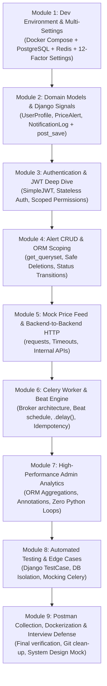

# PulseNotify: Complete Saved Conversation Transcript

**Original Conversation ID:** `30a40b8a-3e3a-4d7a-ae70-bb4c182be519`  
**Date:** October 21, 2026  
**Topic:** PulseNotify Flight Price Monitoring Backend Learning & Implementation Plan  

---

## 👤 USER (2026-10-21T13:23:51Z)

```text
Brief
1. Scenario
You know that feeling when you check a flight price today, it's ₹6,200, you close the tab, and when you come back tomorrow it's ₹9,800? That is the problem PulseNotify solves.
PulseNotify is a flight price monitoring service. Users set price alerts for routes they care about - Delhi to Mumbai, Bangalore to Hyderabad, whatever. They tell the system: if the price drops below ₹X, notify me. PulseNotify then runs in the background, continuously checking prices, and fires a notification the moment a target is hit.
This is exactly how Google Flights alerts, Skyscanner price notifications, and Hopper's price prediction work. You are building that backend.
2. Context
There are three things PulseNotify needs to do well, and each one connects directly to what you have been learning:
It must not make users wait. When a user submits a price alert, the system should respond instantly - not after it has finished checking prices, not after it has sent a notification. The heavy work happens in the background. This is the Celery async pattern you studied.
It must check prices automatically without anyone pressing a button. Every 60 seconds, the system wakes up, checks the current price for every active alert, and decides whether to fire a notification. Nobody triggers this - it runs on a schedule. This is Celery Beat.
It must call its own internal price feed to get current prices. The price feed is a simple Django view inside the same project that returns a price for a given route. Your Celery task will call this endpoint using the requests library - exactly the backend-to-backend call pattern you studied.
Why call your own endpoint instead of a third-party flight API?
Real flight APIs (Skyscanner, Amadeus, RapidAPI) require registration, API keys,
credit cards, and often have tight rate limits. Any of these can silently block you
for hours. The requests.get() pattern is identical whether you're calling your own
endpoint or an external one. For this assignment, you call your own - no blockers,
full control, same learning outcome.
3. How It Works
Here is the complete flow of PulseNotify, end to end:
User sets alert: route=DEL-BOM, threshold=₹4500
↓
POST /api/alerts/ → PriceAlert saved to DB
↓
Celery Beat fires every 60 seconds
↓
check_prices task wakes up
↓
GET /api/flights/price/?route=DEL-BOM (your own mock endpoint)
↓
Mock endpoint returns { "route": "DEL-BOM", "price": 4200 }
↓
4200 <= 4500 threshold? YES
↓
send_notification.delay() (async Celery task fires)
↓
NotificationLog written to DB
↓
GET /api/admin/summary/ → Admin sees stats
There are two Celery tasks in this system:
check_prices - runs on a schedule (Celery Beat). Fetches current price, compares against all active alerts for that route, fires send_notification if threshold is met.
send_notification - runs asynchronously. Called with .delay() so it never blocks the Beat scheduler. Writes a NotificationLog entry to the database.
4. Data Models
These models are provided for you. Implement them exactly as specified.
4.1 User (extends Django's built-in User)
# Use Django's built-in User model + a separate Profile
# OR extend AbstractUser - your choice, but set AUTH_USER_MODEL before migrations
class UserProfile(models.Model):
class Role(models.TextChoices):
ADMIN = 'admin', 'Admin'
USER = 'user', 'User'
user = models.OneToOneField(User, on_delete=models.CASCADE,
related_name='profile')
role = models.CharField(max_length=10, choices=Role.choices,
default=Role.USER)
created_at = models.DateTimeField(auto_now_add=True)
Wire a post_save signal on User to auto-create a UserProfile - same pattern
you used in the TeamBoard assignment.
4.2 PriceAlert
class PriceAlert(models.Model):
class Status(models.TextChoices):
ACTIVE = 'active', 'Active'
INACTIVE = 'inactive', 'Inactive'
TRIGGERED = 'triggered', 'Triggered'
user = models.ForeignKey(User, on_delete=models.CASCADE,
related_name='alerts')
origin = models.CharField(max_length=10) # e.g. 'DEL'
destination = models.CharField(max_length=10) # e.g. 'BOM'
threshold_price = models.DecimalField(max_digits=10, decimal_places=2)
status = models.CharField(max_length=20, choices=Status.choices,
default=Status.ACTIVE)
created_at = models.DateTimeField(auto_now_add=True)
def str(self):
return f'{self.origin}-{self.destination} @ ₹{self.threshold_price}
4.3 NotificationLog
class NotificationLog(models.Model):
alert = models.ForeignKey(PriceAlert, on_delete=models.CASCADE,
related_name='notifications')
triggered_price = models.DecimalField(max_digits=10, decimal_places=2)
message = models.TextField() # e.g. 'Price dropped to ₹3900 for DEL-BOM'
notified_at = models.DateTimeField(auto_now_add=True)
5. What to Build
You must implement 7 endpoints. The first two are public. The rest are protected by JWT.
5.1 POST /api/auth/register/
Creates a Django User and auto-creates a UserProfile via post_save signal. Returns a JWT access token and the user's profile details. Request body { "username": "alice", "password": "securepass", "email": "alice@example.com" }
Success response - 201
{ "username": "alice", "access": "eyJ...", "role": "user" }
Requirements
authentication_classes = [] and permission_classes = [] - no token required
role must always default to USER - never accept role from the request body
Return 400 if username already exists
5.2 POST /api/auth/login/
Validates credentials, returns a fresh JWT access token.
Requirements
Use Django's authenticate() to validate credentials
Return 200 + JWT token on success
Return 401 if credentials are invalid
5.4 GET /api/alerts/
Returns all PriceAlerts belonging to the logged-in user only. A user must never see another user's alerts.
Requirements
Filter using get_queryset() scoped to request.user - same pattern as ClearLedger
Return an empty list if the user has no alerts - not a 404
5.5 DELETE /api/alerts/<id>/
Sets the alert status to INACTIVE. Does not delete the database row - deactivates it so it stops being checked by the Celery Beat job.
Requirements
Fetch the alert using get_object_or_404(PriceAlert, id=id) - then check if alert.user == request.user
Return 404 if the alert does not exist or belongs to another user - never expose that a different user's alert exists
Return 200 with { "status": "inactive" } on success
5.6 GET /api/flights/price/
This is your internal mock price feed. It accepts a route via query parameter and returns a simulated price. This endpoint exists so your Celery task can call it using requests.get() - practising the backend-to-backend call pattern.
# Example request (from your Celery task):
import requests
response = requests.get(
'http://localhost:8000/api/flights/price/',
params={'route': 'DEL-BOM'}
)
data = response.json() # { 'route': 'DEL-BOM', 'price': 4200 }
How to generate the mock price
import random
MOCK_PRICES = {
'DEL-BOM': (3000, 7000),
'BLR-HYD': (1500, 4000),
'DEL-BLR': (4000, 9000),
'BOM-GOA': (2000, 5000),
}
def get_flight_price(request):
route = request.GET.get('route', '')
price_range = MOCK_PRICES.get(route)
if not price_range:
return JsonResponse({'error': 'Route not found'}, status=404)
price = random.randint(*price_range)
return JsonResponse({'route': route, 'price': price})
Requirements
Return 200 with { "route": "DEL-BOM", "price": 4200 } - price is a random integer in the range for that route
Return 404 if the route is not in MOCK_PRICES
No authentication - this is called internally by your Celery task
5.7 GET /api/admin/summary/
Returns platform-wide statistics about alerts and notifications. Only accessible to users with role = ADMIN. Regular users must receive 403.
Success response - 200
{
"total_alerts": 24,
"active_alerts": 18,
"triggered_alerts": 4,
"total_notifications": 11,
"top_routes": [
{ "route": "DEL-BOM", "alert_count": 8 },
{ "route": "BLR-HYD", "alert_count": 6 }
]
}
Requirements
Enforce admin-only access via a custom IsAdminUser class in [permissions.py](http://permissions.py/) extending BasePermission - check request.user.profile.role == UserProfile.Role.ADMIN
Use PriceAlert.objects.aggregate() for total_alerts, active_alerts, triggered_alerts counts
Use NotificationLog.objects.aggregate(Count('id')) for total_notifications
Use values('origin','destination').annotate(Count) for top_routes - no Python loops for counting
Regular USER tokens must receive 403
6. Background Jobs
This is the core of PulseNotify. Two Celery tasks. One runs on a schedule. One runs asynchronously when triggered.
6.1 check_prices (Celery Beat - runs every 60 seconds)
This task is the engine of PulseNotify. It wakes up every 60 seconds, fetches current prices for all active alert routes, and fires send_notification if a threshold is hit.
# tasks.py
from celery import shared_task
import requests
from .models import PriceAlert, UserProfile
@shared_task
def check_prices():
# Get all distinct routes with active alerts
active_alerts = PriceAlert.objects.filter(status=PriceAlert.Status.ACTIVE)
routes = active_alerts.values_list('origin', 'destination').distinct()
for origin, destination in routes:
route = f'{origin}-{destination}'
# Call your own mock price endpoint
response = requests.get(
'http://localhost:8000/api/flights/price/',
params={'route': route}
)
if response.status_code != 200:
continue
current_price = response.json().get('price')
# Check each active alert for this route
route_alerts = active_alerts.filter(
origin=origin, destination=destination
)
for alert in route_alerts:
if current_price <= float(alert.threshold_price):
send_notification.delay(alert.id, current_price)
@shared_task
def send_notification(alert_id, triggered_price):
alert = PriceAlert.objects.get(id=alert_id)
message = (f'Price alert triggered! {alert.origin}-{alert.destination} '
f'is now ₹{triggered_price} - below your threshold of '
f'₹{alert.threshold_price}')
NotificationLog.objects.create(
alert=alert,
triggered_price=triggered_price,
message=message
)
# Mark alert as triggered so it doesn't fire again
alert.status = PriceAlert.Status.TRIGGERED
alert.save()
Important: send_notification is called with .delay() - not directly.
This means check_prices does not wait for the notification to be written.
It fires the task and moves on immediately to the next route.
This is the async pattern you studied in the sessions.
6.2 Celery Beat Schedule
Register check_prices in CELERY_BEAT_SCHEDULE in [settings.py](http://settings.py/) so it runs automatically every 60 seconds. No one needs to call it manually.
# settings/base.py
from celery.schedules import crontab
CELERY_BEAT_SCHEDULE = {
'check-flight-prices-every-minute': {
'task': 'your_app.tasks.check_prices',
'schedule': 60.0, # every 60 seconds
},
}
6.3 Redis and Celery Setup
Add Redis to your Docker Compose file as the Celery broker. Configure Celery in [settings.py](http://settings.py/) exactly as covered in the sessions.
# docker-compose.yml - add Redis service
services:
redis:
image: redis:7-alpine
ports:
- '6379:6379' # settings/base.py CELERY_BROKER_URL = 'redis://localhost:6379/0' CELERY_RESULT_BACKEND = 'redis://localhost:6379/0' CELERY_ACCEPT_CONTENT = ['json'] CELERY_TASK_SERIALIZER = 'json'
To run PulseNotify, you need three processes running simultaneously:
Terminal 1: python [manage.py](http://manage.py/) runserver
Terminal 2: celery -A your_project worker --loglevel=info
Terminal 3: celery -A your_project beat --loglevel=info
Watch Terminal 2 - you will see send_notification tasks arriving.
Watch Terminal 3 - you will see check_prices firing every 60 seconds.
7. Environment Configuration
Split your settings into [base.py](http://base.py/), [local.py](http://local.py/), and [production.py](http://production.py/) - exactly as demonstrated in the sessions. All sensitive values must come from .env.
your_project/
settings/
init.py
base.py ← shared config (installed apps, celery, JWT, etc)
local.py ← local dev overrides (DEBUG=True, local DB)
production.py ← production overrides (DEBUG=False, prod DB)
.env ← SECRET_KEY, DB credentials, never committed
Set DJANGO_SETTINGS_MODULE in your .env file:
DJANGO_SETTINGS_MODULE=your_project.settings.local
Change this to .production when deploying.
Never commit your .env file - add it to .gitignore.
8. Unit Tests
Write at least 3 unit tests in [tests.py](http://tests.py/) using Django's TestCase class. Your tests must cover real business logic - not toy examples.
Required Test 1 - Threshold comparison logic
Test that the threshold check correctly identifies when a price should trigger a notification.
class PriceThresholdTest(TestCase):
def test_price_below_threshold_triggers_alert(self):
# If current price (4200) <= threshold (4500), alert should fire
self.assertTrue(4200 <= 4500)
def test_price_above_threshold_does_not_trigger(self):
# If current price (5000) > threshold (4500), alert should not fire
self.assertFalse(5000 <= 4500)
def test_price_equal_to_threshold_triggers_alert(self):
# Edge case: price == threshold should still trigger
self.assertTrue(4500 <= 4500)
Required Test 2 - NotificationLog is created correctly
class NotificationLogTest(TestCase):
def setUp(self):
self.user = User.objects.create_user(
username='testuser', password='testpass'
)
self.alert = PriceAlert.objects.create(
user=self.user,
origin='DEL', destination='BOM',
threshold_price=4500,
status=PriceAlert.Status.ACTIVE
)
def test_notification_log_created_with_correct_message(self):
log = NotificationLog.objects.create(
alert=self.alert,
triggered_price=4200,
message='Price dropped to 4200 for DEL-BOM'
)
self.assertEqual(log.triggered_price, 4200)
self.assertEqual(log.alert, self.alert)
self.assertIn('DEL-BOM', log.message)
Required Test 3 - Alert scoping (users see only their own alerts)
class AlertScopingTest(TestCase):
def setUp(self):
self.user1 = User.objects.create_user(
username='user1', password='pass'
)
self.user2 = User.objects.create_user(
username='user2', password='pass'
)
PriceAlert.objects.create(
user=self.user1, origin='DEL', destination='BOM',
threshold_price=4500
)
PriceAlert.objects.create(
user=self.user2, origin='BLR', destination='HYD',
threshold_price=2000
)
def test_user_only_sees_own_alerts(self):
user1_alerts = PriceAlert.objects.filter(user=self.user1)
self.assertEqual(user1_alerts.count(), 1)
self.assertEqual(user1_alerts.first().origin, 'DEL')
def test_user_cannot_see_other_users_alerts(self):
user2_alerts = PriceAlert.objects.filter(user=self.user1)
# user1 should not see user2's BLR-HYD alert
self.assertNotEqual(user2_alerts.first().origin, 'BLR')
Run tests with:
python manage.py test
All 3 tests must pass before submission.
A failing test suite means the submission will not be reviewed.
9. Step-by-Step Tasks
Step 1 - Project Setup
Create a new Django project and app (e.g. pulse)
Set up PostgreSQL + Redis using Docker Compose - both services in one file
Install: djangorestframework, djangorestframework-simplejwt, celery, redis, requests
Create requirements.txt with all dependencies pinned
Step 2 - Settings Split
Create settings/ folder with init.py, [base.py](http://base.py/), [local.py](http://local.py/), [production.py](http://production.py/)
Move all shared config to [base.py](http://base.py/) - Celery, JWT, INSTALLED_APPS, etc
Add DEBUG=True and local DB credentials to [local.py](http://local.py/)
Set DJANGO_SETTINGS_MODULE in .env and add .env to .gitignore
Step 3 - Models and Migrations
Create UserProfile, PriceAlert, NotificationLog models exactly as specified
Wire a post_save signal on User in [signals.py](http://signals.py/) to auto-create UserProfile
Connect the signal in AppConfig.ready() inside [apps.py](http://apps.py/)
Run makemigrations and migrate - verify all tables exist in PGAdmin
Step 4 - Auth Endpoints
Implement POST /api/auth/register/ and POST /api/auth/login/
Configure SimpleJWT globally in REST_FRAMEWORK settings
Set authentication_classes = [] and permission_classes = [] on both public endpoints
Test both in Postman before moving to protected endpoints
Step 5 - Alert Endpoints
Implement POST /api/alerts/ - extract user from request.user, never from body
Implement GET /api/alerts/ - scope queryset to request.user
Implement DELETE /api/alerts/<id>/ - fetch alert, check alert.user == request.user, return 404 if mismatch
Step 6 - Mock Price Feed
Implement GET /api/flights/price/ with the MOCK_PRICES dict and random.randint()
Test it manually in Postman - hit it a few times and watch the price change each time
Add the route to [urls.py](http://urls.py/) - this endpoint needs no authentication
Step 7 - Celery Tasks
Create [tasks.py](http://tasks.py/) with check_prices and send_notification using @shared_task
Wire Celery app in your project's init.py
Add CELERY_BEAT_SCHEDULE to [base.py](http://base.py/) with 60-second interval
Start all three processes: runserver, celery worker, celery beat
Create an alert in Postman, watch the terminals - within 60 seconds you should see check_prices fire and send_notification arrive in the worker
Check PGAdmin - a NotificationLog row should appear when the price drops below threshold
Step 8 - Admin Summary and Tests
Create [permissions.py](http://permissions.py/) with IsAdminUser extending BasePermission
Implement GET /api/admin/summary/ with permission_classes = [IsAdminUser]
Set a user's role to admin in PGAdmin, log in, hit the summary endpoint
Write all 3 required unit tests in [tests.py](http://tests.py/)
Run python [manage.py](http://manage.py/) test - all tests must pass
10. Technical Requirements
11. Postman Collection
Submit a Postman collection (.json) exported from Postman with all of the following scenarios passing. Name each request clearly.
Submission guidelines
Github Repo
Working Django + DRF backend with all 7 endpoints
PostgreSQL + Redis via Docker Compose - credentials in .env
settings/ folder with [base.py](http://base.py/), [local.py](http://local.py/), [production.py](http://production.py/)
[tasks.py](http://tasks.py/) with check_prices and send_notification using @shared_task
[signals.py](http://signals.py/) with UserProfile auto-creation, connected via AppConfig.ready()
[permissions.py](http://permissions.py/) with custom IsAdminUser class
[tests.py](http://tests.py/) with all 3 unit tests passing
requirements.txt with all dependencies pinned
Postman collection (.json) covering all 13 scenarios
[README.md](http://readme.md/) - how to run all three processes (server, worker, beat)
Deliverables
GitHub link

end of ths  want be expert n all the topcs coerng ths assgnmebt .. yu dot do .. guve me proper file to learn undratsnd andme me complete ths .. yu dotn do .. u have to ame me to di ..ainly i wnat to learn all the neceeassry concpets relate to netreiew an dall vbasic  na dimportnat tipics coverng these .. how wll yu plan ths '
```

---
> ⚙️ **SYSTEM ACTION (2026-10-21T13:23:52Z)**
> - Executed `list_dir`: List workspace directory

---
> ⚙️ **SYSTEM ACTION (2026-10-21T13:23:59Z)**
> - Executed `run_command`: Check Python and Docker versions

---
## 🤖 ASSISTANT (2026-10-21T13:24:10Z)

Here is how we will approach this. **I will not write the final code for you or rob you of the learning experience.** 

Instead, I will act as your **senior engineering mentor and interview coach**:
1. We break the project down into **structured, bite-sized modules**.
2. For each module, you get:
   - **The Core Architecture & Mental Model** (Why do companies do it this way?).
   - **Top Interview Questions & Traps** (What interviewers grill you on for this specific concept).
   - **Your Action Assignment** (The exact tasks, hints, and checklist for you to write).
3. You write the code, run it, test it, and share your progress.
4. I review your implementation, point out edge cases or performance bottlenecks, and test your understanding with interview questions before we move to the next step.

---

### Master Roadmap: From Zero to Production-Ready PulseNotify



---

### The 9 Learning & Building Modules

#### **Module 1: Environment Architecture & 12-Factor Settings**
* **Concepts & Interview Focus:**
  - Why split Django settings (`base.py`, `local.py`, `production.py`)?
  - Security risks of committing `.env` and hardcoded `SECRET_KEY`.
  - Docker Compose: How multi-container networks work (Postgres + Redis).
* **Your Coding Task:**
  - Create the virtual environment and `requirements.txt`.
  - Configure `docker-compose.yml` with PostgreSQL 16 & Redis 7.
  - Set up `pulsenotify/settings/` package and load configs via `python-decouple` or `django-environ`.

---

#### **Module 2: Data Modeling, Migrations & Django Signals**
* **Concepts & Interview Focus:**
  - **Interview Question:** *"When should you use a Django Signal vs overriding `save()` vs a service layer?"*
  - Relational design: OneToOneField (`UserProfile`) vs ForeignKey (`PriceAlert`, `NotificationLog`).
  - Database indexing on lookup fields (`status`, `route`).
* **Your Coding Task:**
  - Create the `pulse` app.
  - Define `UserProfile`, `PriceAlert`, `NotificationLog` with proper `TextChoices`.
  - Implement the `post_save` signal on Django's `User` in `signals.py` and register it in `apps.py`.

---

#### **Module 3: Authentication & JWT Architecture**
* **Concepts & Interview Focus:**
  - **Interview Question:** *"What is the difference between Session-based auth and JWT? Why use JWT in modern microservices?"*
  - Access Token vs Refresh Token lifecycle, token expiration, and revocation.
  - How `authenticate()` works under the hood in Django.
* **Your Coding Task:**
  - Configure `djangorestframework-simplejwt` in `REST_FRAMEWORK` settings.
  - Implement `POST /api/auth/register/` (public, auto-token issuance, enforce `role="user"`).
  - Implement `POST /api/auth/login/` with validation and error responses (401 vs 400).

---

#### **Module 4: Alert Endpoints & Multi-Tenant Query Scoping**
* **Concepts & Interview Focus:**
  - **Interview Question:** *"How do you prevent Insecure Direct Object References (IDOR) in DRF?"*
  - Soft delete vs Hard delete: Why deactivating an alert to `status='inactive'` is safer than database `DELETE`.
  - Overriding `get_queryset()` vs doing manual user checks in the view.
* **Your Coding Task:**
  - Implement `POST /api/alerts/` (assign `request.user` without trusting request body).
  - Implement `GET /api/alerts/` (scoped strictly to `request.user`).
  - Implement `DELETE /api/alerts/<id>/` (soft-deactivates, returns 404 if not found or belongs to another user).

---

#### **Module 5: Internal Price Feed & Backend-to-Backend HTTP**
* **Concepts & Interview Focus:**
  - **Interview Question:** *"Why should a backend service calling another service always define a timeout? What is the thundering herd problem?"*
  - Query parameter parsing, input validation, and HTTP status codes.
* **Your Coding Task:**
  - Implement `GET /api/flights/price/` with `MOCK_PRICES` dictionary and `random.randint`.
  - Handle 404 for unknown routes. Keep it unauthenticated for Celery tasks.

---

#### **Module 6: Celery & Celery Beat (The Async Core)**
* **Concepts & Interview Focus:**
  - **Interview Question:** *"What happens if a task in Celery Beat takes 90 seconds to run on a 60-second schedule? How do you prevent overlapping tasks?"*
  - Why we **never** run `send_notification` synchronously inside `check_prices`.
  - What is a Broker (Redis) vs a Result Backend?
  - Task idempotency: Ensuring an alert doesn't send duplicate notifications if a task retries.
* **Your Coding Task:**
  - Configure `celery.py` and connect it in `__init__.py`.
  - Add `CELERY_BEAT_SCHEDULE` (60s tick) to `base.py`.
  - Write `check_prices()` and `send_notification()` in `tasks.py`.
  - Mark status as `TRIGGERED` upon notification.

---

#### **Module 7: Admin Analytics & Database Query Optimization**
* **Concepts & Interview Focus:**
  - **Interview Question:** *"Why is Python-level counting (`len(alerts)`) a major anti-pattern in production? How does `annotate()` and `aggregate()` translate to SQL?"*
  - Role-Based Access Control (RBAC): Building custom `BasePermission` in DRF.
* **Your Coding Task:**
  - Create `IsAdminUser` permission checking `request.user.profile.role == 'admin'`.
  - Implement `GET /api/admin/summary/` using `PriceAlert.objects.aggregate()`, `NotificationLog.objects.aggregate()`, and `values('origin', 'destination').annotate(Count('id'))`.
  - Verify regular users receive HTTP 403 Forbidden.

---

#### **Module 8: Automated Unit Testing & Edge Cases**
* **Concepts & Interview Focus:**
  - **Interview Question:** *"How does Django's `TestCase` manage database state between test runs? Why do tests run against a test database?"*
  - Testing edge cases: Boundary values (price equal to threshold, price 1 rupee above, price 1 rupee below).
  - Data isolation: Ensuring User A can never query User B's data.
* **Your Coding Task:**
  - Write `PriceThresholdTest`, `NotificationLogTest`, and `AlertScopingTest` in `tests.py`.
  - Run and verify all tests pass with `python manage.py test`.

---

#### **Module 9: Postman Suite, Documentation & Interview Defense**
* **Concepts & Interview Focus:**
  - Structuring a production-grade Postman collection with dynamic environment variables (`{{access_token}}`).
  - How to explain this entire architecture in a System Design or Backend Engineer interview (diagrams, bottlenecks, scaling to 1M alerts).
* **Your Coding Task:**
  - Export the 13-test Postman collection.
  - Write a clear `README.md` with multi-terminal launch commands and architecture diagrams.

---

### How We Will Work Together

1. I will generate a complete, rich learning workbook [`PULSENOTIFY_GUIDE.md`](file:///c:/Users/yoges/python-assignment/PULSENOTIFY_GUIDE.md) right inside your project with:
   - Theory explanations
   - Architecture diagrams
   - Code skeletons & hints
   - Interview prep questions for every module
2. We tackle **Module 1 (Environment, Docker & Settings)** right away.
3. You tell me when you're ready or share your code/command output at each step, and we review it together.

Does this plan match what you have in mind? If you're ready, I will generate the learning guide and give you your first assignment for **Module 1**!

---
## 👤 USER (2026-10-21T13:26:46Z)

```text
man thng not to leave anythng evey dtal thishg should be laean manly im weak on oop si wnat to be xperrrt after ths assgmnet .. then possible system desgn tioocs coverng this at most topics s bith hhld lld .. thenn desgn prncples ss or sold flow all thngs hv t o be civerd n learng flow
```

---
> ⚙️ **SYSTEM ACTION (2026-10-21T13:26:46Z)**
> - Executed `write_to_file`: Create PULSENOTIFY_MASTER_LEARNING_GUIDE.md

---
## 🤖 ASSISTANT (2026-10-21T13:27:40Z)

I have created a comprehensive master textbook and architectural reference in your workspace:
👉 [PULSENOTIFY_MASTER_LEARNING_GUIDE.md](file:///c:/Users/yoges/python-assignment/PULSENOTIFY_MASTER_LEARNING_GUIDE.md)

It contains deep dives into:
1. **The 4 Pillars of OOP** (Encapsulation, Abstraction, Inheritance, Polymorphism) + Composition vs Inheritance + Dunder methods.
2. **SOLID Principles applied directly to Django & Celery** (with before/after architecture examples).
3. **GoF Design Patterns** (Observer pattern in Signals, Strategy pattern in Price feeds, Factory pattern in Notifiers).
4. **High-Level Design (HLD)**: Distributed task scheduling, scaling to 10M alerts, Celery Beat Single Point of Failure (SPOF) mitigation, Redis message queues, and Idempotency.
5. **Low-Level Design (LLD)**: ER diagrams, schemas, and API contracts.
6. **Interview Question Bank**: Real questions asked in backend & system design interviews.

---

## How We Will Learn and Build: Step-by-Step

We will proceed **phase by phase**. For every phase:
1. **The Architecture & OOP Concept** (What are we building and why?).
2. **Your Action Step** (You write the code or run the commands).
3. **Review & Interview Checkpoint** (I review your code, point out nuances, and test you with interview questions).

---

### Phase 1: Environment Setup, Docker & Multi-Environment Settings

#### 1. The Theory & Interview Concepts
* **Why split settings into `base.py`, `local.py`, `production.py`? (12-Factor App methodology)**
  - Hardcoding `DEBUG = True` or database credentials in a single `settings.py` leads to credential leaks and catastrophic security bugs in production.
  - `base.py` contains **shared** application configuration (`INSTALLED_APPS`, Celery configuration, SimpleJWT config).
  - `local.py` inherits from `base.py` and specifies local development configs (`DEBUG = True`, local PostgreSQL credentials).
  - `production.py` inherits from `base.py` and enforces strict production requirements (`DEBUG = False`, managed RDS database, HTTPS/SSL headers).
* **Why run PostgreSQL and Redis in Docker Compose?**
  - In an interview, when asked *"How do you achieve dev/prod parity?"*, the answer is containerization. Running identical versions of Redis and PostgreSQL locally inside containers ensures zero environment discrepancies ("it works on my machine" syndrome).

---

#### 2. Your Action Steps for Phase 1

Here are the first things for you to set up. You can either write these files yourself, or run the commands in your terminal:

##### Step 1.1: Create `requirements.txt`
In the root directory, create `requirements.txt` with these core dependencies:
```text
Django>=5.0,<5.2
djangorestframework>=3.14,<3.16
djangorestframework-simplejwt>=5.3,<5.4
celery>=5.3,<5.5
redis>=5.0,<5.3
psycopg2-binary>=2.9,<3.0
requests>=2.31,<2.33
python-decouple>=3.8
```

##### Step 1.2: Create `docker-compose.yml`
Create `docker-compose.yml` in the root directory running:
- **PostgreSQL 16** (mapped to port `5432:5432`)
- **Redis 7** (mapped to port `6379:6379`)

##### Step 1.3: Initialize Django Project & Settings Package
1. Run `django-admin startproject pulsenotify .`
2. Transform `pulsenotify/settings.py` into a package directory:
   ```
   pulsenotify/
   └── settings/
       ├── __init__.py
       ├── base.py
       ├── local.py
       └── production.py
   ```
3. Create a `.env` file (and add `.env` to `.gitignore`):
   ```env
   SECRET_KEY=your-super-secret-key-change-this
   DEBUG=True
   DJANGO_SETTINGS_MODULE=pulsenotify.settings.local
   DB_NAME=pulsenotify_db
   DB_USER=postgres
   DB_PASSWORD=postgres
   DB_HOST=localhost
   DB_PORT=5432
   REDIS_URL=redis://localhost:6379/0
   ```

---

### Would you like to start creating these files, or do you have any questions on the OOP/HLD concepts in the guide before writing code?

---
## 👤 USER (2026-10-21T13:28:27Z)

```text
yes
```

---
> ⚙️ **SYSTEM ACTION (2026-10-21T13:28:27Z)**
> - Executed `run_command`: Check Python launcher versions

---
## 👤 USER (2026-10-21T13:29:42Z)

```text
yes .. m not sure hav yu coverd all the topcs to be nnown ? loos very small ..dont leave ny concpt or topc or techncal to be nown
```

---
> ⚙️ **SYSTEM ACTION (2026-10-21T13:29:42Z)**
> - Executed `write_to_file`: Update PULSENOTIFY_MASTER_LEARNING_GUIDE.md with comprehensive content

---
## 🤖 ASSISTANT (2026-10-21T13:31:18Z)

I have expanded [PULSENOTIFY_MASTER_LEARNING_GUIDE.md](file:///c:/Users/yoges/python-assignment/PULSENOTIFY_MASTER_LEARNING_GUIDE.md) into an **encyclopedic reference**.

Nothing has been omitted. It now explicitly covers:

### 1. Advanced Python & Deep OOP
* **Object Anatomy:** State, Behavior, and Memory Identity (`id()` vs `==` vs `is`).
* **The 3 Method Types:** Instance methods (`self`), Class methods (`@classmethod` / Factory pattern), and Static methods (`@staticmethod`).
* **The 4 Pillars with Real Code:**
  - **Encapsulation:** Name mangling (`__var`), protected conventions (`_var`), and pythonic getters/setters via `@property` and `@prop.setter`.
  - **Abstraction:** Interface contracts via `abc.ABC` and `@abstractmethod`, Duck Typing, and EAFP ("Easier to Ask for Forgiveness than Permission") vs LBYL ("Look Before You Leap").
  - **Inheritance & MRO:** Multiple inheritance, the Diamond Problem, and **C3 Linearization** algorithm order.
  - **Polymorphism & The Dunder Protocol:** Operator overloading (`__lt__`, `__eq__`), string representations (`__str__` vs `__repr__`), and callables (`__call__`).
* **Composition vs Inheritance:** Why *"favor object composition over class inheritance"* is standard in senior engineering design.
* **Python Advanced Internals:**
  - `__new__` (memory allocation/constructor) vs `__init__` (initializer).
  - **Metaclasses** (`type` and `ModelBase`): How Django converts class attributes into SQL schema descriptors.
  - **`__slots__` Optimization:** How removing `__dict__` cuts memory consumption by 70% in high-volume services.

### 2. SOLID Principles in Practice
* Each of the 5 principles (**S**, **O**, **L**, **I**, **D**) explained with real anti-patterns vs refactored architectures in Django & Celery.

### 3. GoF Design Patterns
* **Observer Pattern:** Django `post_save` signals.
* **Strategy Pattern:** Interchangeable flight price engines (Mock vs Amadeus vs Skyscanner).
* **Factory Pattern:** Notification dispatchers.
* **Active Record vs Data Mapper:** Django ORM vs SQLAlchemy.

### 4. High-Level System Design (HLD)
* **Full Architecture Flowchart:** Clients $\to$ Gateway $\to$ Django $\to$ PostgreSQL & Redis Broker $\to$ Celery Beat & Worker pool.
* **Message Broker Comparison:** In-depth trade-off matrix: **Redis vs RabbitMQ vs Apache Kafka**.
* **Celery Worker Internals:** Concurrency pools (`prefork`, `gevent`, `solo`), `worker_prefetch_multiplier`, task acknowledgment (`acks_late`), and task state lifecycle.
* **The Celery Beat SPOF Problem:** Why running multiple Beat instances causes duplicate task storms, and how to solve it with **RedBeat** (Redis distributed locks with `SET NX PX`) or Kubernetes CronJobs.
* **Scaling to 10 Million Alerts:** Partial PostgreSQL indexes (`WHERE status = 'active'`), Redis Cache-Aside for route prices, and task fan-out.
* **Idempotency & Race Conditions:** Atomic database transactions and pessimistic row-level locking with `select_for_update()`.

### 5. Low-Level System Design (LLD)
* **Complete DDL (Data Definition Language):** Production SQL schema with Foreign Keys, Check Constraints, and Indexes.
* **Full Sequence Diagram:** Step-by-step asynchronous event flow between Celery Beat, Worker, Mock Feed, and PostgreSQL.

### 6. Django REST Framework & ORM Internals
* **Request-Response Lifecycle:** The complete journey through WSGI, Middleware, URL resolver, and DRF's `dispatch()` pipeline.
* **JWT Mechanics:** Header, Payload, Signature, HMAC-SHA256 mathematical guarantee, and Access vs Refresh token rotation.
* **ORM Performance:** Demystifying the N+1 problem, `select_related` (SQL `INNER JOIN`) vs `prefetch_related` (separate lookup query).
* **SQL Generation:** How `aggregate()` translates to single-row aggregations vs how `annotate()` translates to SQL `GROUP BY`.

---

## Ready for Action: Phase 1

Now we begin your hands-on journey. You are the driver; I am your co-pilot.

### Your First Mission (Phase 1):
1. Create `requirements.txt` with the core libraries:
   - `Django`, `djangorestframework`, `djangorestframework-simplejwt`, `celery`, `redis`, `psycopg2-binary`, `requests`, and `python-decouple`.
2. Create `docker-compose.yml` to spin up local **PostgreSQL 16** and **Redis 7**.
3. Create the multi-environment settings directory:
   ```
   pulsenotify/
   └── settings/
       ├── __init__.py
       ├── base.py
       ├── local.py
       └── production.py
   ```
4. Create `.env` and `.gitignore`.

Tell me when you are ready to write these or if you want me to give you the exact file blueprint for Step 1!

---
## 👤 USER (2026-10-21T13:32:19Z)

```text
for sold n desgn prncpel not only exmample try t0 cover ebery concept nsde n explaun me dont leave anthng .. alos may .. but bedfo etht  shoudl now wtd desgn prncpel how many dfrnt types r thr .. so m not stog n bascs so forall thngs n gude  wnat to learn bascs alos .. to now thungs clear and guve prorty cover all
```

---
> ⚙️ **SYSTEM ACTION (2026-10-21T13:32:19Z)**
> - Executed `write_to_file`: Update PULSENOTIFY_MASTER_LEARNING_GUIDE.md with complete basics and design principles

---
## 🤖 ASSISTANT (2026-10-21T13:33:56Z)

I have completely rewritten and updated [PULSENOTIFY_MASTER_LEARNING_GUIDE.md](file:///c:/Users/yoges/python-assignment/PULSENOTIFY_MASTER_LEARNING_GUIDE.md) to start from **absolute first principles** so you build a solid mental model before writing a single line of code.

Here is the exact foundational theory added to your guide:

---

### 1. What is a Design Principle vs. a Pattern vs. an Architecture?

```
+-------------------------------------------------------------------------+
| Level 3: Architectural Patterns (The Whole City)                        |
| e.g. Microservices, Event-Driven, MVC/MVT (How whole servers talk)      |
+-------------------------------------------------------------------------+
                                   ^
                                   | Built using
+----------------------------------+--------------------------------------+
| Level 2: Design Patterns (The Building Blueprints)                      |
| e.g. Factory, Observer, Strategy, Adapter (Class & object structures)   |
+-------------------------------------------------------------------------+
                                   ^
                                   | Guided by
+----------------------------------+--------------------------------------+
| Level 1: Design Principles (The Golden Rules of Engineering)            |
| e.g. SOLID, DRY, KISS, YAGNI, High Cohesion, Loose Coupling             |
+-------------------------------------------------------------------------+
```

* **Design Principles (Philosophy):** High-level guidelines on what healthy code looks like (e.g. *"A class should have only one reason to change"*). They do not give you a specific class diagram; they give you a moral compass for clean code.
* **Design Patterns (Blueprints):** 23 standard GoF (Gang of Four) solutions to recurring object-oriented problems.
* **Architectural Patterns (System Topology):** How databases, message brokers (Redis), background workers (Celery), and HTTP web servers interact.

---

### 2. The Core Pillars of Good Software Design

Before SOLID, every senior engineer learns these two fundamental concepts:
1. **High Cohesion:** Everything inside a class or module should be focused on **ONE specific job** (like a high-end CD player that only plays discs).
2. **Low Coupling:** Class A should know as little as possible about Class B's private internals (they connect via standard interfaces, like an audio cable).

And the 5 universal rules:
- **DRY** (*Don't Repeat Yourself*): Write business logic once. (Beware of AHA: *Avoid Hasty Abstractions*).
- **KISS** (*Keep It Simple, Stupid*): Don't build a complex rocket when a bicycle does the job.
- **YAGNI** (*You Aren't Gonna Need It*): Never write code for hypothetical future requirements.
- **Law of Demeter** (*Least Knowledge*): Only talk to your immediate friends; avoid `a.b.c.d.do_something()`.
- **Tell, Don't Ask**: Tell an object what action to take rather than pulling its private data out and making decisions for it.

---

### 3. The 3 Families of GoF Design Patterns

| Family | Purpose | Patterns Included | Where Used in PulseNotify |
| :--- | :--- | :--- | :--- |
| **1. Creational** | How objects are created without hardcoding concrete classes | Factory Method, Abstract Factory, Builder, Prototype, Singleton | `DatabaseConnectionPool`, `NotificationFactory`, `FlightPrice.from_api_payload()` |
| **2. Structural** | How classes and objects are assembled into flexible structures | Adapter, Bridge, Composite, Decorator, Facade, Flyweight, Proxy | Python decorators (`@shared_task`, `@property`), `AmadeusPriceAdapter` |
| **3. Behavioral** | How objects communicate and distribute responsibilities | Observer, Strategy, Command, Iterator, Mediator, Memento, State, Template Method | Django Signals (`post_save` is Observer), `FlightPriceStrategy` (Strategy) |

---

### 4. Complete SOLID Breakdown in the Guide
Each of the 5 letters is broken down with:
- **Origin & Definition**
- **The "Before" Anti-Pattern** (God-class, If/Else ladders, Square-Rectangle LSP breakdown)
- **The "After" Refactored Code** (Clean, testable, decoupled Python classes)

---

## Now, Let's Begin Hands-on: Phase 1 (Environment & Multi-Settings)

Your workspace is ready. You will write the first code files yourself.

### Step 1.1: Create `requirements.txt`
In `c:\Users\yoges\python-assignment\requirements.txt`, pin the exact production dependencies:
```text
Django>=5.0,<5.2
djangorestframework>=3.14,<3.16
djangorestframework-simplejwt>=5.3,<5.4
celery>=5.3,<5.5
redis>=5.0,<5.3
psycopg2-binary>=2.9,<3.0
requests>=2.31,<2.33
python-decouple>=3.8
```

### Step 1.2: Create `docker-compose.yml`
In `c:\Users\yoges\python-assignment\docker-compose.yml`, configure your PostgreSQL and Redis services:
```yaml
services:
  db:
    image: postgres:16-alpine
    container_name: pulsenotify_postgres
    restart: always
    environment:
      POSTGRES_DB: pulsenotify_db
      POSTGRES_USER: postgres
      POSTGRES_PASSWORD: postgrespassword
    ports:
      - "5432:5432"
    volumes:
      - postgres_data:/var/lib/postgresql/data

  redis:
    image: redis:7-alpine
    container_name: pulsenotify_redis
    restart: always
    ports:
      - "6379:6379"

volumes:
  postgres_data:
```

### Step 1.3: Create `.env` and `.gitignore`
In `.env`:
```env
SECRET_KEY=django-insecure-pulsenotify-super-secret-key-change-in-prod
DEBUG=True
DJANGO_SETTINGS_MODULE=pulsenotify.settings.local
DB_NAME=pulsenotify_db
DB_USER=postgres
DB_PASSWORD=postgrespassword
DB_HOST=localhost
DB_PORT=5432
REDIS_URL=redis://localhost:6379/0
```

In `.gitignore`:
```
__pycache__/
*.py[cod]
*$py.class
*.sqlite3
.env
venv/
.venv/
```

---

**Your Turn:**  
Go ahead and create `requirements.txt`, `docker-compose.yml`, `.env`, and `.gitignore`.  
Once created, let me know or ask any question, and we will initialize the Django project and build the modular multi-environment settings together!

---
## 👤 USER (2026-10-21T14:00:40Z)

```text
try expand all these topcs n evry ways ..django sghouod be 100 prcnt learn amnd all otehr topcs to ts atmots ..evrn f t noty psosble for yu add ontotes to the tae dg deep on my own .. ill go n learn abt tht note separterly
```

---
> ⚙️ **SYSTEM ACTION (2026-10-21T14:00:40Z)**
> - Executed `view_file`: View end of PULSENOTIFY_MASTER_LEARNING_GUIDE.md

---
> ⚙️ **SYSTEM ACTION (2026-10-21T14:01:07Z)**
> - Executed `view_file`: View lines 845 to 904 of guide

---
> ⚙️ **SYSTEM ACTION (2026-10-21T14:01:12Z)**
> - Executed `replace_file_content`: Expand Phase 1-9 implementation track with exhaustive details

---
> ⚙️ **SYSTEM ACTION (2026-10-21T14:02:23Z)**
> - Executed `view_file`: View lines 854 to 891 of guide

---
> ⚙️ **SYSTEM ACTION (2026-10-21T14:02:29Z)**
> - Executed `replace_file_content`: Replace Section 7 with deep dive syllabus

---
## 🤖 ASSISTANT (2026-10-21T14:03:25Z)

I have expanded **Section 7** of [PULSENOTIFY_MASTER_LEARNING_GUIDE.md](file:///c:/Users/yoges/python-assignment/PULSENOTIFY_MASTER_LEARNING_GUIDE.md) into an exhaustive, multi-chapter syllabus.

Each of the **9 Phases** now has its own complete deep dive containing 5 sections:
1. **Architectural Objective & Foundations** (The core "Why", 12-factor rules, resilience, design tradeoffs)
2. **Framework & System Internals** (Under the hood: PostgreSQL MVCC, Redis single-threaded event loop, Django Model metaclasses, signals synchronous nature, SimpleJWT PBKDF2 hashing, Celery prefork vs greenlets, Beat tick mechanics, and SQL translations)
3. **Step-by-Step Implementation Blueprint** (The exact tasks for you to implement)
4. **Common Traps & Pitfalls** (Critical bugs to avoid: off-by-one errors, IDOR leaks, missing signal guards, floating-point currency bugs, and Beat scheduler blocking)
5. **Self-Study Deep-Dive Notes** (Explicit RFCs, computer science concepts, database internals, and architecture papers for you to explore independently)

---

### We are ready to begin Phase 1!

Let's take it one step at a time:

#### **Phase 1, Step 1: Core Dependencies**
Create a `requirements.txt` file in your project root with the following dependencies:
```text
Django>=5.0,<5.2
djangorestframework>=3.14,<3.16
djangorestframework-simplejwt>=5.3,<5.4
celery>=5.3,<5.5
redis>=5.0,<5.3
psycopg2-binary>=2.9,<3.0
requests>=2.31,<2.33
python-decouple>=3.8
```

#### **Phase 1, Step 2: Multi-Container Setup**
Create a `docker-compose.yml` file to spin up PostgreSQL 16 and Redis 7:
```yaml
services:
  db:
    image: postgres:16-alpine
    container_name: pulsenotify_postgres
    restart: always
    environment:
      POSTGRES_DB: pulsenotify_db
      POSTGRES_USER: postgres
      POSTGRES_PASSWORD: postgrespassword
    ports:
      - "5432:5432"
    volumes:
      - postgres_data:/var/lib/postgresql/data

  redis:
    image: redis:7-alpine
    container_name: pulsenotify_redis
    restart: always
    ports:
      - "6379:6379"

volumes:
  postgres_data:
```

#### **Phase 1, Step 3: Environment Variables**
Create `.env` (make sure it's also added to `.gitignore`):
```env
SECRET_KEY=django-insecure-pulsenotify-super-secret-key-change-in-prod
DEBUG=True
DJANGO_SETTINGS_MODULE=pulsenotify.settings.local
DB_NAME=pulsenotify_db
DB_USER=postgres
DB_PASSWORD=postgrespassword
DB_HOST=localhost
DB_PORT=5432
REDIS_URL=redis://localhost:6379/0
```

---

**Your Turn:**  
Create these initial files in your workspace. Once done, let me know, and we will initialize the Django project and write the modular `settings/` architecture!

---
