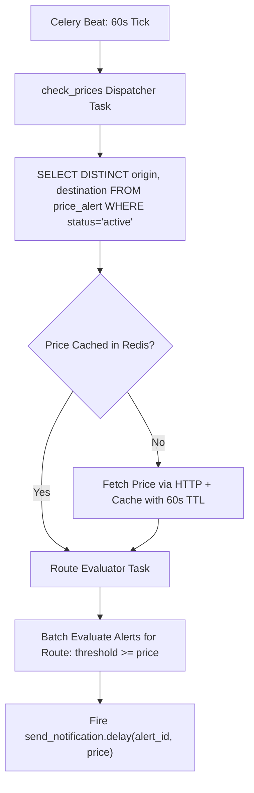

# PulseNotify: The Master Engineering, OOP, SOLID & Distributed System Design Encyclopedia

> **Target Audience:** Backend Engineers, Software Engineers preparing for Senior/Staff Technical & System Design Interviews.  
> **Philosophy:** Learn the fundamentals from scratch with zero jargon, understand the "WHY" behind every decision, master OOP & Design Principles, and apply them directly to building a production-grade distributed flight price monitoring backend (**PulseNotify**).

---

# Table of Contents
1. [Foundations of Software Design: The Big Picture](#1-foundations-of-software-design-the-big-picture)
   - 1.1 What is Software Design? Why Do We Need Principles?
   - 1.2 Principles vs. Patterns vs. Architectures
   - 1.3 Cohesion vs. Coupling (The Two Pillars of Good Design)
   - 1.4 The Universal Design Principles: DRY, KISS, YAGNI, SoC, Law of Demeter, Tell-Don't-Ask
2. [SOLID Principles: Complete Theory, History & Code](#2-solid-principles-complete-theory-history--code)
   - 2.1 Single Responsibility Principle (SRP)
   - 2.2 Open/Closed Principle (OCP)
   - 2.3 Liskov Substitution Principle (LSP)
   - 2.4 Interface Segregation Principle (ISP)
   - 2.5 Dependency Inversion Principle (DIP)
3. [Design Patterns: The 3 GoF Families & Backend Applications](#3-design-patterns-the-3-gof-families--backend-applications)
   - 3.1 What is a Design Pattern?
   - 3.2 Creational Patterns (Factory, Singleton, Builder, Prototype)
   - 3.3 Structural Patterns (Adapter, Decorator, Facade, Proxy)
   - 3.4 Behavioral Patterns (Observer, Strategy, Template Method, Command)
   - 3.5 Active Record (Django ORM) vs. Data Mapper (SQLAlchemy)
4. [Python Object-Oriented Programming (OOP) From Scratch to Advanced](#4-python-object-oriented-programming-oop-from-scratch-to-advanced)
   - 4.1 Classes, Objects, Instances & Memory Identity (`id()` vs `==` vs `is`)
   - 4.2 The Three Method Types (`self`, `@classmethod`, `@staticmethod`)
   - 4.3 Pillar 1: Encapsulation & Data Hiding (`_`, `__`, Name Mangling, `@property`)
   - 4.4 Pillar 2: Abstraction & Interface Contracts (`abc.ABC`, Duck Typing, EAFP vs LBYL)
   - 4.5 Pillar 3: Inheritance, MRO & C3 Linearization (The Diamond Problem)
   - 4.6 Pillar 4: Polymorphism & Operator Overloading (The Dunder Protocol)
   - 4.7 Composition vs. Inheritance (Delegation, Mixins, Decoupling)
   - 4.8 Advanced Python Internals: `__new__` vs `__init__`, Metaclasses in Django, `__slots__`
5. [High-Level System Design (HLD)](#5-high-level-system-design-hld)
   - 5.1 End-to-End Distributed Architecture Diagram
   - 5.2 Message Brokers: Redis vs. RabbitMQ vs. Apache Kafka
   - 5.3 Celery Worker Internals: Execution Pools, Prefetch Multiplier, ACK Semantics
   - 5.4 The Celery Beat Distributed Scheduling Problem (SPOF & Redlock)
   - 5.5 Scaling to 10 Million Alerts: Partial Indexes, Redis Cache-Aside, Task Fan-Out
   - 5.6 Idempotency & Exactly-Once Semantics in Asynchronous Processing
6. [Low-Level System Design (LLD)](#6-low-level-system-design-lld)
   - 6.1 Database Schema (DDL) with Foreign Keys & Performance Indexes
   - 6.2 Component Class Diagram (UML)
   - 6.3 Sequence Diagrams (Authentication, Scheduled Tick, Asynchronous Notification)
7. [Django REST Framework & Database Internals](#7-django-rest-framework--database-internals)
   - 7.1 Request-Response Lifecycle & Middleware Pipeline
   - 7.2 Stateless Authentication with JWT (HMAC-SHA256, Refresh Token Rotation)
   - 7.3 DRF Permission & Validation Pipeline
   - 7.4 ORM Query Optimization: N+1 Problem, `select_related` vs `prefetch_related`
   - 7.5 Aggregation (`aggregate`) vs Annotation (`annotate`) & SQL `GROUP BY`
   - 7.6 Concurrency & Race Conditions (`select_for_update` vs Optimistic Locking)
8. [The 9-Phase Step-by-Step Hands-On Implementation Track](#8-the-9-phase-step-by-step-hands-on-implementation-track)
9. [Comprehensive Technical & Interview Question Bank](#9-comprehensive-technical--interview-question-bank)

---

# 1. Foundations of Software Design: The Big Picture

If you are weak in the basics, this section builds your foundation from the ground up.

## 1.1 What is Software Design? Why Do We Need Principles?

When people first learn to code, they write **procedural scripts**: a single file that runs from top to bottom. It works for a 50-line script.

However, as software grows:
- **Code Rot:** Changing one line of code in file A mysteriously breaks file B.
- **Fragility:** Adding a small feature requires rewriting half the application.
- **Un-testability:** You cannot test price calculations without actually making HTTP requests and writing to a live database.

**Software Design** is the art of structuring code so that it is:
1. **Maintainable:** Easy for another engineer to understand and modify months later.
2. **Extensible:** Easy to add new features without breaking existing functionality.
3. **Testable:** Easy to verify individual components in automated tests without relying on live external networks.

---

## 1.2 Principles vs. Patterns vs. Architectures

Developers often confuse these three terms. Here is the hierarchy:

```
+-------------------------------------------------------------------------+
| Level 3: Architectural Patterns (System-Wide)                           |
| e.g. Microservices, Event-Driven, MVC, Clean / Hexagonal Architecture   |
+-------------------------------------------------------------------------+
                                   ^
                                   | Built using
+----------------------------------+--------------------------------------+
| Level 2: Design Patterns (Class & Object Level)                         |
| e.g. Factory, Observer, Strategy, Adapter (Concrete reusable blueprints)|
+-------------------------------------------------------------------------+
                                   ^
                                   | Guided by
+----------------------------------+--------------------------------------+
| Level 1: Design Principles (Philosophical Guidelines)                   |
| e.g. SOLID, DRY, KISS, Loose Coupling, High Cohesion                   |
+-------------------------------------------------------------------------+
```

1. **Design Principles (The Philosophy):** High-level rules of thumb (e.g., "Don't repeat yourself", "Keep responsibilities focused"). They tell you *what good code looks like*, but they don't give you a specific class diagram.
2. **Design Patterns (The Blueprints):** Specific, repeatable solutions to recurring object-oriented problems (e.g., "How do I let objects subscribe to events?" $\to$ Observer Pattern).
3. **Architectures (The City Plan):** How entire systems, servers, databases, and message brokers talk to each other (e.g., Client $\to$ Django $\to$ Redis $\to$ Celery Workers).

---

## 1.3 Cohesion vs. Coupling (The Two Pillars of Good Design)

Every design principle exists to achieve two goals: **High Cohesion** and **Low Coupling**.

```
+-----------------------------------+     +-----------------------------------+
|            COHESION               |     |             COUPLING              |
|   (Inside a Single Module/Class)  |     |   (Between Two Different Modules) |
+-----------------------------------+     +-----------------------------------+
| High Cohesion = GOOD              |     | Low Coupling = GOOD               |
| Everything inside this class is   |     | Class A knows very little about   |
| closely related to ONE job.       |     | the inner workings of Class B.    |
|                                   |     |                                   |
| Low Cohesion = BAD                |     | High Coupling = BAD               |
| A "God Class" that handles auth,  |     | Class A directly modifies private |
| DB writes, emails, and PDFs.      |     | variables inside Class B.         |
+-----------------------------------+     +-----------------------------------+
```

### Real-World Analogy:
- **A Stereo System (High Cohesion, Low Coupling):**
  - The CD player has one job: read discs (**High Cohesion**).
  - The amplifier has one job: amplify audio (**High Cohesion**).
  - They connect via a standard 3.5mm audio jack (**Low Coupling**). You can replace the CD player with a Bluetooth receiver, and the amplifier still works without any modifications!
- **A Cheap All-in-One Boombox (Low Cohesion, High Coupling):**
  - If the tape deck breaks, you have to throw the entire radio and speakers in the trash because they are soldered onto a single circuit board.

---

## 1.4 The Universal Design Principles

Before learning SOLID, every senior engineer masters these foundational principles:

### 1. DRY: Don't Repeat Yourself
- **Meaning:** Every piece of knowledge or business logic must have a single, unambiguous representation in a system.
- **Example in PulseNotify:** If the logic to calculate whether a price triggers an alert (`price <= threshold`) is copied into the view, the Celery task, and the admin serializer, changing the rule (e.g. to `<`) requires hunting down 3 places. Put it in one place (the model method).
- **Caveat (AHA - Avoid Hasty Abstractions):** Duplication is far cheaper than the wrong abstraction. Don't merge two pieces of code just because they look similar today if they represent different business concepts.

### 2. KISS: Keep It Simple, Stupid
- **Meaning:** Most systems work best if they are kept simple rather than made complex. Avoid unnecessary over-engineering.
- **Example:** Don't set up a distributed Apache Kafka cluster with ZooKeeper if all you need is a Celery queue backed by Redis to handle 500 tasks per minute.

### 3. YAGNI: You Aren't Gonna Need It
- **Meaning:** Never implement a feature or abstraction based on what you *might* need in the future. Implement it only when you actually need it.

### 4. Separation of Concerns (SoC)
- **Meaning:** Break a computer program into distinct sections, such that each section addresses a separate concern.
  - In Django:
    - `models.py` = Data persistence and schema concern.
    - `serializers.py` = Data parsing, validation, and serialization concern.
    - `views.py` = HTTP request parsing and response status code concern.
    - `tasks.py` = Background asynchronous execution concern.

### 5. Law of Demeter (Principle of Least Knowledge)
- **Meaning:** *"Only talk to your immediate friends."* An object should avoid reaching deep into other objects via multiple dots (`a.b.c.d.do_something()`).
- **Violation:** `alert.user.profile.notification_preference.email_frequency`
- **Solution:** Add a shortcut method on `alert`: `alert.get_user_email_frequency()`.

### 6. Tell, Don't Ask
- **Meaning:** Do not ask an object about its internal state and then make decisions for it. Instead, **tell** the object what to do.
- **Bad (Asking):**
  ```python
  if alert.status == 'active' and current_price <= alert.threshold_price:
      alert.status = 'triggered'
  ```
- **Good (Telling):**
  ```python
  alert.evaluate_and_trigger(current_price)
  ```

---

# 2. SOLID Principles: Complete Theory, History & Code

SOLID was introduced by Robert C. Martin ("Uncle Bob") in the early 2000s. It stands for 5 design principles for maintainable, testable object-oriented software:

```
S -> Single Responsibility Principle (SRP)
O -> Open/Closed Principle (OCP)
L -> Liskov Substitution Principle (LSP)
I -> Interface Segregation Principle (ISP)
D -> Dependency Inversion Principle (DIP)
```

---

## 2.1 Single Responsibility Principle (SRP)

> **Definition:** *"A class should have one, and only one, reason to change."*  
> Another way to state it: *"A module should be responsible to one, and only one, actor (stakeholder/user)."*

### The Problem:
A class that handles multiple concerns (e.g. database access + HTTP formatting + emailing) will need to be modified whenever ANY of those three things change.

### Before SRP (Anti-Pattern: The God Class)
```python
# BAD: This class changes if DB changes, IF price API changes, OR IF email provider changes!
class PriceAlertManager:
    def process_alert(self, alert_id: int):
        # Reason to change 1: Database ORM logic
        alert = PriceAlert.objects.get(id=alert_id)
        
        # Reason to change 2: External flight API protocol changes
        response = requests.get(f"https://flights.com/api?route={alert.origin}-{alert.destination}")
        current_price = response.json()["price"]
        
        # Reason to change 3: Business calculation rule
        if current_price <= alert.threshold_price:
            # Reason to change 4: Email SMTP configuration
            import smtplib
            server = smtplib.SMTP('smtp.mail.com', 587)
            server.sendmail("noreply@pulse.com", alert.user.email, f"Price dropped to {current_price}")
            
            alert.status = "triggered"
            alert.save()
```

### After SRP (Refactored Clean Code)
Every class has a single actor and single reason to change:
1. `FlightPriceClient`: Only changes if the flight price provider's API changes.
2. `PriceEvaluator`: Only changes if the threshold business logic changes.
3. `NotificationDispatcher`: Only changes if how we send notifications changes.
4. `PriceAlertService`: Orchestrates the flow without doing the low-level work.

```python
class FlightPriceClient:
    """Single Responsibility: Network I/O with Flight Provider."""
    def get_price(self, route: str) -> float:
        resp = requests.get(f"http://localhost:8000/api/flights/price/?route={route}", timeout=5)
        return resp.json()["price"]

class NotificationDispatcher:
    """Single Responsibility: Sending notifications and logging audit records."""
    def dispatch(self, alert: PriceAlert, price: float):
        NotificationLog.objects.create(
            alert=alert,
            triggered_price=price,
            message=f"Price dropped to ₹{price} for {alert.origin}-{alert.destination}"
        )

class PriceAlertService:
    """Single Responsibility: Domain logic orchestration."""
    def __init__(self, client: FlightPriceClient, notifier: NotificationDispatcher):
        self.client = client
        self.notifier = notifier

    def evaluate_alert(self, alert: PriceAlert):
        price = self.client.get_price(f"{alert.origin}-{alert.destination}")
        if price <= float(alert.threshold_price):
            alert.status = PriceAlert.Status.TRIGGERED
            alert.save(update_fields=['status'])
            self.notifier.dispatch(alert, price)
```

---

## 2.2 Open/Closed Principle (OCP)

> **Definition:** *"Software entities (classes, modules, functions) should be open for extension, but closed for modification."*  
> (Formulated by Bertrand Meyer in 1988).

### The Meaning:
You should be able to add new functionality to a system **without changing existing, tested source code**. You do this using **polymorphism and inheritance**.

### Before OCP (Anti-Pattern: The If/Else Ladder)
Suppose we want to add SMS and WhatsApp notifications alongside Database notifications:

```python
# BAD: Every time a new notification method is added, we MUST MODIFY this class!
class NotificationSender:
    def send(self, channel: str, alert, price):
        if channel == "database":
            NotificationLog.objects.create(alert=alert, triggered_price=price)
        elif channel == "email":
            send_email(alert.user.email, f"Price is {price}")
        elif channel == "sms":
            send_twilio_sms(alert.user.phone, f"Price is {price}")
        elif channel == "whatsapp":
            send_whatsapp_msg(alert.user.phone, f"Price is {price}")
        # If Twilio API changes, we risk breaking database logging!
```

### After OCP (Clean Polymorphic Extension)
Define an abstract interface. To add WhatsApp, you create a new class without touching existing classes:

```python
from abc import ABC, abstractmethod

class BaseNotificationChannel(ABC):
    @abstractmethod
    def send(self, alert: PriceAlert, price: float):
        pass

class DatabaseNotificationChannel(BaseNotificationChannel):
    def send(self, alert: PriceAlert, price: float):
        NotificationLog.objects.create(
            alert=alert,
            triggered_price=price,
            message=f"Price dropped to ₹{price} for {alert.origin}-{alert.destination}"
        )

class EmailNotificationChannel(BaseNotificationChannel):
    def send(self, alert: PriceAlert, price: float):
        # Email sending logic
        print(f"Email sent to {alert.user.email}")

class WhatsAppNotificationChannel(BaseNotificationChannel):
    """Added weeks later! Zero modifications made to Database or Email classes!"""
    def send(self, alert: PriceAlert, price: float):
        print(f"WhatsApp sent for alert {alert.id}")
```

---

## 2.3 Liskov Substitution Principle (LSP)

> **Definition:** *"If $S$ is a subtype of $T$, then objects of type $T$ may be replaced with objects of type $S$ without altering any of the desirable properties of the program (correctness, task performed, etc.)."*  
> (Formulated by Barbara Liskov in 1987).

### Plain English Translation:
A child class must be completely interchangeable with its parent class. If a function expects a `BasePermission`, any subclass you pass to it must behave according to the contract without crashing, returning unexpected types, or violating assumptions.

### The Classic LSP Violation: The Square-Rectangle Problem
In geometry, a Square is a Rectangle. But in OOP:
```python
class Rectangle:
    def __init__(self, width: float, height: float):
        self._width = width
        self._height = height

    def set_width(self, w: float):
        self._width = w

    def set_height(self, h: float):
        self._height = h

    def area(self) -> float:
        return self._width * self._height

class Square(Rectangle):
    """VIOLATES LSP! Mutating width mutates height, breaking caller assumptions."""
    def set_width(self, w: float):
        self._width = w
        self._height = w

    def set_height(self, h: float):
        self._width = h
        self._height = h

def test_area_doubling(rect: Rectangle):
    rect.set_width(5)
    rect.set_height(4)
    # The caller assumes area is ALWAYS 20 (5 * 4)
    assert rect.area() == 20, f"Expected 20, got {rect.area()}"

# Works fine:
test_area_doubling(Rectangle(0, 0))

# CRASHES! With Square, area is 16 (4 * 4) because set_height also changed width!
test_area_doubling(Square(0, 0))
```

### LSP in Django REST Framework:
When you inherit from `rest_framework.permissions.BasePermission`:
- The contract specifies `has_permission(self, request, view) -> bool`.
- **LSP Violation:** If your custom permission returns `None`, or raises a raw `KeyError` instead of returning `False`, DRF's permission pipeline breaks because it expected a pure boolean.

---

## 2.4 Interface Segregation Principle (ISP)

> **Definition:** *"Clients should not be forced to depend upon interfaces that they do not use."*

### The Problem:
Bloated ("Fat") interfaces. If an interface defines 10 methods, and a class only needs 2 of them, that class is forced to implement 8 dummy/empty methods (`pass` or `raise NotImplementedError`).

### Before ISP (Fat Interface)
```python
class FlightOperationsInterface(ABC):
    @abstractmethod
    def get_ticket_price(self, route: str) -> float:
        pass

    @abstractmethod
    def book_seat(self, flight_id: str, passenger: str) -> str:
        pass

    @abstractmethod
    def cancel_ticket(self, booking_ref: str) -> bool:
        pass

# BAD: PulseNotify ONLY checks prices! Why force it to implement seat booking and cancellations?
class PulseNotifyPriceChecker(FlightOperationsInterface):
    def get_ticket_price(self, route: str) -> float:
        return 4200.0

    def book_seat(self, flight_id: str, passenger: str) -> str:
        raise NotImplementedError("PulseNotify does not book flights!")

    def cancel_ticket(self, booking_ref: str) -> bool:
        raise NotImplementedError("PulseNotify cannot cancel flights!")
```

### After ISP (Segregated, Granular Interfaces)
Split the fat interface into smaller, focused interfaces:

```python
class PriceQueryInterface(ABC):
    @abstractmethod
    def get_ticket_price(self, route: str) -> float:
        pass

class BookingInterface(ABC):
    @abstractmethod
    def book_seat(self, flight_id: str, passenger: str) -> str:
        pass

# Clean: PulseNotify only implements what it uses!
class PulseNotifyPriceChecker(PriceQueryInterface):
    def get_ticket_price(self, route: str) -> float:
        return 4200.0
```

---

## 2.5 Dependency Inversion Principle (DIP)

> **Definition:**  
> 1. *"High-level modules should not depend on low-level modules. Both should depend on abstractions."*  
> 2. *"Abstractions should not depend on details. Details should depend on abstractions."*

### Why DIP Matters in PulseNotify:
- **High-level module:** `check_prices` task (the core business engine).
- **Low-level module:** The HTTP network library (`requests.get('http://localhost:8000/api/flights/price/')`).

If `check_prices` imports `requests` directly and hardcodes the URL, you cannot test it without running the HTTP server. You cannot switch to another flight API without modifying the task.

### Applying DIP:
1. Define an abstract abstraction (`FlightPriceProvider`).
2. Make `check_prices` depend on `FlightPriceProvider`.
3. Pass (inject) the concrete implementation at runtime.

```python
class FlightPriceProvider(ABC):
    @abstractmethod
    def get_price(self, origin: str, destination: str) -> float:
        pass

class HttpInternalPriceProvider(FlightPriceProvider):
    def __init__(self, base_url: str = "http://localhost:8000"):
        self.base_url = base_url

    def get_price(self, origin: str, destination: str) -> float:
        resp = requests.get(f"{self.base_url}/api/flights/price/", params={"route": f"{origin}-{destination}"})
        return resp.json()["price"]

# IN TESTS: We inject a Fake provider without hitting any network!
class FakePriceProvider(FlightPriceProvider):
    def __init__(self, price_to_return: float):
        self.price = price_to_return

    def get_price(self, origin: str, destination: str) -> float:
        return self.price
```

---

# 3. Design Patterns: The 3 GoF Families & Backend Applications

In 1994, the "Gang of Four" (Erich Gamma, Richard Helm, Ralph Johnson, John Vlissides) cataloged **23 Classic Design Patterns** divided into 3 families:

```
+-------------------------------------------------------------------------------+
|                        THE 3 FAMILIES OF GOF PATTERNS                         |
+-------------------+---------------------------+-------------------------------+
| Family            | Purpose                   | The Patterns                  |
+-------------------+---------------------------+-------------------------------+
| 1. CREATIONAL     | How objects are created   | Factory Method, Abstract      |
|                   | without hardcoding `new`  | Factory, Builder, Prototype,  |
|                   | or class names.           | Singleton                     |
+-------------------+---------------------------+-------------------------------+
| 2. STRUCTURAL     | How classes & objects are | Adapter, Bridge, Composite,   |
|                   | assembled into larger     | Decorator, Facade, Flyweight, |
|                   | structures.               | Proxy                         |
+-------------------+---------------------------+-------------------------------+
| 3. BEHAVIORAL     | How objects communicate   | Observer, Strategy, Command,  |
|                   | and distribute work.      | Iterator, Mediator, Memento,  |
|                   |                           | State, Template Method, etc.  |
+-------------------+---------------------------+-------------------------------+
```

---

## 3.1 Creational Patterns

### The Factory Pattern
- **Problem:** Client code needs to create objects, but doesn't know in advance which concrete class to instantiate.
- **Solution:** A factory class or classmethod that takes parameters and returns the correct instance.

```python
class NotificationFactory:
    @staticmethod
    def get_channel(channel_type: str) -> BaseNotificationChannel:
        if channel_type == "database":
            return DatabaseNotificationChannel()
        elif channel_type == "email":
            return EmailNotificationChannel()
        raise ValueError(f"Unsupported channel: {channel_type}")
```

### The Singleton Pattern
- **Problem:** Ensuring a class has **only one instance** globally and providing a global point of access to it (e.g. database connection pool, logger, Django's `settings`).
- **Python Implementation via `__new__`:**
```python
class DatabaseConnectionPool:
    _instance = None

    def __new__(cls, *args, **kwargs):
        if cls._instance is None:
            # First time: allocate memory and save instance
            cls._instance = super().__new__(cls)
            cls._instance._initialized = False
        return cls._instance

    def __init__(self):
        if not self._initialized:
            print("Connecting to PostgreSQL pool...")
            self._initialized = True

pool1 = DatabaseConnectionPool()
pool2 = DatabaseConnectionPool()
print(pool1 is pool2) # True! Exactly the same object in memory!
```

---

## 3.2 Structural Patterns

### The Adapter Pattern
- **Problem:** Two classes have incompatible interfaces and cannot work together directly.
- **Solution:** An adapter wraps one object and exposes the interface the other object expects (like a US-to-UK plug converter).

```python
# Third-party Amadeus SDK (cannot be modified)
class AmadeusFlightSDK:
    def search_offers(self, departure_code: str, arrival_code: str) -> dict:
        return {"data": [{"price": {"total": "4500.00"}}]}

# Our Application expects BaseFlightPriceProvider.fetch_price(route)
class AmadeusPriceAdapter(BasePriceFeed):
    def __init__(self, sdk: AmadeusFlightSDK):
        self.sdk = sdk

    def fetch_price(self, route: str) -> float:
        origin, dest = route.split("-")
        res = self.sdk.search_offers(departure_code=origin, arrival_code=dest)
        return float(res["data"][0]["price"]["total"])
```

### The Decorator Pattern
- **Problem:** Add behavior to an individual object dynamically without affecting other objects or modifying the class.
- In Python, decorators (`@shared_task`, `@receiver`, `@property`) are first-class language constructs implementing this pattern!

---

## 3.3 Behavioral Patterns

### The Observer Pattern (Used in Django Signals)
- **Problem:** When one object changes state, an unknown number of other objects need to be notified automatically without tight coupling.
- **Components:**
  - **Subject / Publisher:** Holds list of observers. Emits event (`post_save`).
  - **Observer / Subscriber:** Registers with subject. Executes handler when notified.

```
[Django User.save()] ---> Emits post_save Signal
                                 |
         +-----------------------+-----------------------+
         |                                               |
         v                                               v
[Observer 1: create_user_profile]               [Observer 2: send_welcome_email]
(Creates UserProfile with role='user')          (Dispatches async Celery task)
```

### The Strategy Pattern (Used in Flight Pricing)
- **Problem:** You have a family of algorithms/behaviors, and you want to swap them dynamically at runtime.
- **In PulseNotify:** Swap between `MockPriceStrategy`, `LiveScraperStrategy`, and `DatabaseHistoricalStrategy` without changing `check_prices`.

---

# 4. High-Level System Design (HLD)

### 4.1 End-to-End Distributed Architecture

```
                                  +-----------------------+
                                  | Client (Browser/App)  |
                                  +-----------+-----------+
                                              | HTTPS (JWT Auth)
                                              v
                                  +-----------------------+
                                  | Nginx / Load Balancer |
                                  +-----------+-----------+
                                              |
                                              v
                            +-----------------------------------+
                            | Django Application (WSGI/Gunicorn)|
                            +---+---------------------------+---+
                                |                           |
               ORM Query (SQL)  |                           | Async Enqueue (.delay())
                                v                           v
                     +--------------------+       +--------------------+
                     | PostgreSQL 16      |       | Redis 7 Broker     |
                     |  - auth_user       |       |  - Celery Queue    |
                     |  - pulse_userprof. |       +---------+----------+
                     |  - pulse_priceal.  |                 |
                     |  - pulse_notiflog  |                 | Worker Pops Tasks
                     +---------+----------+                 v
                               ^                  +--------------------+
          Scheduled 60s Tick   |                  | Celery Worker Pool |
                     +---------+----------+       |  - check_prices    |
                     | Celery Beat Engine | ----> |  - send_notif.     |
                     +--------------------+       +---------+----------+
                                                            |
                                        HTTP GET Price Feed | (Internal Mock)
                                                            v
                                                  +--------------------+
                                                  | /api/flights/price/|
                                                  +--------------------+
```

---

### 4.2 Message Brokers: Redis vs. RabbitMQ vs. Apache Kafka

| Feature | Redis | RabbitMQ | Apache Kafka |
| :--- | :--- | :--- | :--- |
| **Architecture** | In-Memory Key-Value / List | Message Queue (AMQP) | Distributed Append-Only Log |
| **Delivery Guarantee** | At-least-once (with ACK) | At-least-once / Exactly-once | At-least-once |
| **Persistence** | RDB snapshots / AOF logs | Erlang Mnesia on Disk | Segmented partition commit logs |
| **Routing** | Simple FIFO (`LPUSH`/`RPOP`) | Advanced (Fanout, Topic, Direct) | Topic partitions |
| **Throughput** | 100k+ ops/sec (In-memory) | 20k–50k msgs/sec | 1,000,000+ msgs/sec |
| **Best Used For** | Fast background tasks, caching | Enterprise financial workflows | Event streaming, log aggregation |

---

### 4.3 Celery Worker Internals: Concurrency & Prefetch
- **Execution Pools:**
  - `prefork` (Default): Uses Python `multiprocessing` to bypass the GIL. One master process forks $N$ child processes (where $N$ = number of CPU cores).
  - `gevent` / `eventlet`: Coroutine cooperative multitasking. Uses greenlets to handle 1,000+ concurrent network socket requests in a single thread.
- **The Prefetch Multiplier Trap:**
  - By default, Celery prefetches $4 \times \text{concurrency}$ tasks from Redis into local worker memory.
  - If task A takes 30 seconds and tasks B, C, D take 10ms, tasks B, C, D will sit starved in worker 1's memory buffer while worker 2 sits idle!
  - **Solution for long tasks:** Set `CELERY_WORKER_PREFETCH_MULTIPLIER = 1` and `task_acks_late = True`.

---

### 4.4 The Celery Beat Distributed Scheduling Problem (SPOF)
- Celery Beat maintains an internal heap clock.
- **Problem:** If you deploy your app across 3 Kubernetes pods, running Beat on all 3 pods means **every scheduled task runs 3 times simultaneously**!
- **Mitigation:**
  1. Run Celery Beat on a single dedicated pod (SPOF risk).
  2. Use **RedBeat** (Redis-backed scheduler using distributed mutex locks via `SET beat_lock <token> NX PX 30000`). Only the pod holding the lock generates the ticks.

---

### 4.5 Scaling to 10 Million Alerts
If 10,000,000 alerts are active, checking them row-by-row in a loop crashes the server.



1. **Partial Indexing:**
   ```sql
   CREATE INDEX idx_active_routes ON pulse_pricealert (origin, destination) 
   WHERE status = 'active';
   ```
   This index ignores 90% of the table (inactive and triggered alerts) and indexes ONLY the active rows.
2. **Redis Cache-Aside for Prices:**
   - Instead of fetching prices 10,000,000 times, query the unique route pairs (~5,000 routes).
   - Fetch the price for `DEL-BOM` **once**, cache in Redis with a 60-second TTL.
   - All 50,000 users watching `DEL-BOM` compare against the single cached price.
3. **Chunking & Task Fan-Out:**
   - Worker 1 queries the distinct routes.
   - Worker 1 dispatches 5,000 lightweight subtasks (`evaluate_route_alerts.delay(origin, dest, price)`).
   - A cluster of 50 worker nodes processes the 5,000 subtasks in parallel across the cluster!

---

# 5. Low-Level System Design (LLD)

### 5.1 Database Schema (DDL)

```sql
-- Extends Django auth_user
CREATE TABLE pulse_userprofile (
    id BIGSERIAL PRIMARY KEY,
    user_id INT UNIQUE NOT NULL REFERENCES auth_user(id) ON DELETE CASCADE,
    role VARCHAR(10) NOT NULL DEFAULT 'user' CHECK (role IN ('admin', 'user')),
    created_at TIMESTAMP WITH TIME ZONE DEFAULT CURRENT_TIMESTAMP
);

-- Flight Price Alerts
CREATE TABLE pulse_pricealert (
    id BIGSERIAL PRIMARY KEY,
    user_id INT NOT NULL REFERENCES auth_user(id) ON DELETE CASCADE,
    origin VARCHAR(10) NOT NULL,
    destination VARCHAR(10) NOT NULL,
    threshold_price NUMERIC(10, 2) NOT NULL,
    status VARCHAR(20) NOT NULL DEFAULT 'active' CHECK (status IN ('active', 'inactive', 'triggered')),
    created_at TIMESTAMP WITH TIME ZONE DEFAULT CURRENT_TIMESTAMP
);

-- Notification Audit Logs
CREATE TABLE pulse_notificationlog (
    id BIGSERIAL PRIMARY KEY,
    alert_id BIGINT NOT NULL REFERENCES pulse_pricealert(id) ON DELETE CASCADE,
    triggered_price NUMERIC(10, 2) NOT NULL,
    message TEXT NOT NULL,
    notified_at TIMESTAMP WITH TIME ZONE DEFAULT CURRENT_TIMESTAMP
);

-- Performance Indexes
CREATE INDEX idx_alert_user ON pulse_pricealert(user_id);
CREATE INDEX idx_alert_route_status ON pulse_pricealert(origin, destination, status);
CREATE INDEX idx_notification_alert ON pulse_notificationlog(alert_id);
```

---

### 5.2 Component Class Diagram (UML)

```
+------------------------------------+
|            UserProfile             |
+------------------------------------+
| - id: int                          |
| - user: User (OneToOne)            |
| - role: TextChoices ('admin','user)|
| - created_at: datetime             |
+------------------------------------+
                  ^
                  | 1-to-1
+-----------------+------------------+
|           auth_user                |
+------------------------------------+
| - id: int                          |
| - username: str                    |
| - password: str (hashed)           |
| - email: str                       |
+-----------------+------------------+
                  | 1-to-N
                  v
+------------------------------------+
|            PriceAlert              |
+------------------------------------+
| - id: int                          |
| - user: User (ForeignKey)          |
| - origin: str                      |
| - destination: str                 |
| - threshold_price: Decimal         |
| - status: TextChoices              |
| - created_at: datetime             |
+-----------------+------------------+
| + __str__(): str                   |
+-----------------+------------------+
                  | 1-to-N
                  v
+------------------------------------+
|          NotificationLog           |
+------------------------------------+
| - id: int                          |
| - alert: PriceAlert (ForeignKey)   |
| - triggered_price: Decimal         |
| - message: str                     |
| - notified_at: datetime            |
+------------------------------------+
```

---

# 6. Django REST Framework & Database Internals

### 6.1 The Request-Response Lifecycle
1. **Socket Connection:** Client establishes TCP connection to WSGI server (Gunicorn).
2. **WSGI Handler:** Parses raw HTTP bytes into a Python `environ` dictionary and creates an `HttpRequest`.
3. **Middleware Pipeline:**
   - Executes `process_request` sequentially through each middleware in `settings.MIDDLEWARE`.
   - `AuthenticationMiddleware` extracts credentials and binds `request.user`.
4. **URL Resolver:** Matches route in `urls.py`.
5. **DRF APIView `dispatch()`:**
   - Wraps `HttpRequest` into a DRF `Request` object.
   - Runs `initial()`:
     - Authentication (`JWTAuthentication.authenticate()`).
     - Permissions (`IsAdminUser.has_permission()`).
     - Throttling (Rate limits).
6. **Handler Method:** Executes view code (`get()`, `post()`, etc.).
7. **Response Rendering:** Transforms Python dictionaries into JSON strings with appropriate HTTP status codes.

---

### 6.2 Stateless Authentication with JWT
A JSON Web Token consists of 3 parts separated by dots (`.`):
```
eyJhbGciOiJIUzI1NiIsInR5cCI6IkpXVCJ9.eyJ1c2VyX2lkIjoxLCJyb2xlIjoidXNlciIsImV4cCI6MTY5ODAwMDB9.s8Df93mK...
[----- Header (Algorithm) -----].[--------- Payload (Claims) ---------].[--------- Signature ---------]
```
- **Why is it stateless?** The server does not look up a session in a database. It simply recalculates `HMAC-SHA256(Header + "." + Payload, SECRET_KEY)`. If the calculated signature matches the token's signature, the token is mathematically guaranteed to be authentic and untampered.

---

### 6.3 ORM Query Optimization: The N+1 Problem
If you have 100 alerts and iterate over them:
```python
# BAD: Executes 1 query for alerts, PLUS 100 queries for users = 101 queries!
alerts = PriceAlert.objects.all()
for a in alerts:
    print(a.user.username)

# GOOD: Executes 1 SINGLE query with SQL INNER JOIN
alerts = PriceAlert.objects.select_related('user').all()
for a in alerts:
    print(a.user.username)
```

---

### 6.4 Aggregation (`aggregate`) vs Annotation (`annotate`)
* **`aggregate()`:** Collapses entire table into one row (dictionary).
  ```python
  PriceAlert.objects.aggregate(total=Count('id'))
  # SQL: SELECT COUNT(id) FROM pulse_pricealert;
  ```
* **`annotate()`:** Calculates values per group (QuerySet of rows).
  ```python
  PriceAlert.objects.values('origin', 'destination').annotate(count=Count('id'))
  # SQL: SELECT origin, destination, COUNT(id) FROM pulse_pricealert GROUP BY origin, destination;
  ```

---

# 7. The 9-Phase Step-by-Step Hands-On Implementation Track (Deep Dive Syllabus)

This section breaks down each of the 9 phases into complete engineering depth. For each phase, you will master:
1. **Architectural Objective & Foundations** (The "Why")
2. **Django & Framework Internals** (Under the Hood)
3. **Step-by-Step Implementation Blueprint** (Your code tasks)
4. **Common Traps, Pitfalls & Bugs to Avoid**
5. **Self-Study Deep-Dive Notes** (Topics for further independent mastery)

---

## Phase 1: Environment & Multi-Settings Architecture

### 1. Architectural Objective & Foundations
- **The Problem:** Beginners put `DEBUG = True`, SQLite database paths, and raw passwords in a single `settings.py`. When committed to GitHub or deployed, secret keys leak, debugging consoles expose remote code execution (RCE) vulnerabilities, and local databases conflict with production.
- **The 12-Factor App Methodology (Factor III: Config):** Strict separation of config from code. Everything that varies between deployments (credentials, hosts, debug flags) must be injected via environment variables.
- **Settings Inheritance Pattern:**
  ```
                 [ pulsenotify/settings/base.py ]
                     (Shared: Apps, Middleware, Celery, JWT)
                               /          \
                              /            \
  [ pulsenotify/settings/local.py ]    [ pulsenotify/settings/production.py ]
   - DEBUG = True                       - DEBUG = False
   - Local PostgreSQL credentials       - Managed AWS RDS / Cloud Postgres
   - Console email backend              - AWS SES / SendGrid
   - Permissive CORS                    - Strict Allowed Hosts & SSL Headers
  ```

### 2. Framework & System Internals
- **`DJANGO_SETTINGS_MODULE`:** When Django boots via `manage.py` or WSGI, it checks `os.environ["DJANGO_SETTINGS_MODULE"]`. Django imports that Python module, reads all uppercase attributes into `django.conf.settings`, and locks them against runtime modification.
- **Docker Compose Networking:** Docker creates a default user-defined bridge network. Services resolve each other by container name as hostname (e.g., `db:5432`, `redis:6379`). However, your host machine running Django locally talks to them via `localhost:5432` and `localhost:6379` because of the `ports: ["5432:5432"]` forwarding.
- **PostgreSQL MVCC (Multi-Version Concurrency Control):** PostgreSQL does not lock entire tables during writes. When a row is updated, it creates a new version of the tuple (`xmin`/`xmax` tracking). Readers never block writers, and writers never block readers.
- **Redis In-Memory Engine:** Redis executes commands on a single-threaded event loop (using `epoll`/`kqueue`). Because everything resides in RAM, operations take microseconds with zero thread context switching.

### 3. Step-by-Step Implementation Blueprint
1. Create `requirements.txt` with pinned versions (`Django`, `djangorestframework`, `djangorestframework-simplejwt`, `celery`, `redis`, `psycopg2-binary`, `requests`, `python-decouple`).
2. Create `docker-compose.yml` with PostgreSQL 16 Alpine and Redis 7 Alpine.
3. Create `.env` containing `SECRET_KEY`, `DEBUG`, `DJANGO_SETTINGS_MODULE`, and DB credentials.
4. Convert `pulsenotify/settings.py` into a package:
   - `pulsenotify/settings/__init__.py`
   - `pulsenotify/settings/base.py` (imports `decouple.config`, defines base apps)
   - `pulsenotify/settings/local.py` (`from .base import *`, sets local DB and DEBUG)
   - `pulsenotify/settings/production.py` (`from .base import *`, sets DEBUG=False)

### 4. Common Traps & Pitfalls
- **Trap 1:** Committing `.env` to Git. Always verify `.gitignore` contains `.env` before running `git add .`.
- **Trap 2:** Using `psycopg2` instead of `psycopg2-binary` on Windows/Mac dev machines without local C compiler toolchains installed.
- **Trap 3:** Circular imports when importing models or settings too early in `base.py`. Never import application models inside settings files.

### 5. Self-Study Deep-Dive Notes (For Independent Research)
- *The Twelve-Factor App Manifesto (12factor.net)*: Focus on Factor III (Config), Factor VI (Processes), and Factor XI (Logs).
- *PostgreSQL Write-Ahead Logging (WAL)*: How PostgreSQL guarantees durability (ACID) by appending transactions to disk sequentially before writing to heap pages.
- *Redis Persistence Models*: Differences between RDB (point-in-time snapshots) and AOF (Append-Only File command logging) and when each is appropriate.

---

## Phase 2: Domain Modeling & Django Signals

### 1. Architectural Objective & Foundations
- **Domain Modeling:** Designing data structures that accurately represent the problem domain invariants (routes, thresholds, notification states) while enforcing relational constraints (referential integrity, foreign key cascades).
- **Extending Django User vs Profile:** Why we use `OneToOneField(UserProfile)`:
  - Django's built-in `auth_user` model handles password hashing, sessions, and core auth.
  - Adding domain-specific metadata (`role = 'admin' | 'user'`) via a separate `UserProfile` preserves the default User model and avoids difficult schema migrations if `AUTH_USER_MODEL` was not set before the initial migration.

### 2. Framework & System Internals
- **Django Model Metaclass (`ModelBase`):** When Python parses `class PriceAlert(models.Model)`, `ModelBase` intercepts field definitions (`CharField`, `DecimalField`), generates the underlying database schema metadata (`_meta`), and registers database descriptors for attribute getters/setters.
- **Database Foreign Keys & Cascades (`on_delete`):**
  - `CASCADE`: Deleting a `User` automatically deletes all their `PriceAlert` records and their `UserProfile`.
  - `PROTECT`: Prevents deletion of the referenced object by raising `ProtectedError`.
  - `SET_NULL`: Sets the foreign key column to `NULL` (requires `null=True`).
- **Django Signals Mechanism:**
  - Signals are an implementation of the **Observer Pattern**.
  - **CRITICAL MISCONCEPTION:** Django Signals are **SYNCHRONOUS**, not asynchronous! When `User.save()` executes, the `post_save` receiver executes in the **exact same Python thread and database transaction**. If the receiver is slow, the entire registration request hangs! Signals are NOT background jobs.
  - Registration via `@receiver(post_save, sender=User)` requires connecting in `AppConfig.ready()` in `apps.py`, or Django will never discover the listener.

### 3. Step-by-Step Implementation Blueprint
1. Define `UserProfile` with `Role` (`TextChoices`), `user` (`OneToOneField`), `role`, `created_at`.
2. Define `PriceAlert` with `Status` (`TextChoices`: `ACTIVE`, `INACTIVE`, `TRIGGERED`), `user` (`ForeignKey`), `origin`, `destination`, `threshold_price`, `status`, `created_at`.
3. Define `NotificationLog` with `alert` (`ForeignKey`), `triggered_price`, `message`, `notified_at`.
4. Create `signals.py` with `create_user_profile(sender, instance, created, **kwargs)`.
5. Connect signals inside `PulseConfig.ready()` in `apps.py`.
6. Run `python manage.py makemigrations pulse` and `python manage.py migrate`.

### 4. Common Traps & Pitfalls
- **Trap 1:** Missing `if created:` guard in the `post_save` signal. Without `if created:`, updating a user's password or email later will try to create a duplicate `UserProfile`, crashing with an `IntegrityError`!
- **Trap 2:** Forgetting `default_app_config` or neglecting `apps.py ready()` hook, causing signals to silently never fire.
- **Trap 3:** Using `FloatField` instead of `DecimalField` for financial data. Floating-point arithmetic produces precision errors (`0.1 + 0.2 = 0.30000000000000004`). Always use `DecimalField(max_digits=10, decimal_places=2)`.

### 5. Self-Study Deep-Dive Notes (For Independent Research)
- *Django Migrations Dependency Graph*: How Django calculates topological order of migration operations and handles circular migration dependencies.
- *Martin Fowler's Active Record Pattern*: How Django models map a single database row to an object with business logic, contrasted with Martin Fowler's *Data Mapper Pattern* (used by SQLAlchemy and Hibernate).
- *Database Normalization (1NF, 2NF, 3NF, BCNF)*: Understanding transitive dependencies and why separating User from UserProfile satisfies 3rd Normal Form.

---

## Phase 3: Authentication & SimpleJWT

### 1. Architectural Objective & Foundations
- **Stateful vs Stateless Authentication:**
  - *Session-Based (Stateful):* Client receives a `sessionid` cookie. Server looks up session in PostgreSQL/Redis on every HTTP request. Fails to scale horizontally across microservices without a shared distributed session cache.
  - *JWT-Based (Stateless):* Server cryptographically signs a payload containing user claims and expiry. The server validates the cryptographic signature on each request without touching the database!
- **Access vs Refresh Tokens:**
  - Access Token: Short lifetime (e.g. 5–15 minutes). Sent in `Authorization: Bearer <token>`. Minimizes window of vulnerability if intercepted.
  - Refresh Token: Long lifetime (e.g. 1–7 days). Stored securely. Sent to `/api/auth/token/refresh/` to obtain a new access token without re-entering passwords.

### 2. Framework & System Internals
- **Password Hashing with Salt:** Django uses **PBKDF2 with SHA-256** (with 720,000 iterations by default). A unique cryptographic random "salt" is generated per user to prevent Rainbow Table attacks. Passwords are NEVER stored in plaintext.
- **Django `authenticate(username=..., password=...)`:** Runs through `AUTHENTICATION_BACKENDS`. Fetches user, extracts salt from password hash, applies PBKDF2 iterations, and performs constant-time string comparison (`secrets.compare_digest`) to prevent timing attacks.
- **DRF Request Authentication Lifecycle:**
  - When a request hits an `APIView`, DRF loops through `authentication_classes`.
  - For `JWTAuthentication`, it extracts the `Bearer <token>` string from the `Authorization` header, decodes the base64 payload, verifies HMAC-SHA256 signature using `SECRET_KEY`, checks `exp > now()`, fetches the `User` record, and attaches it to `request.user`.

### 3. Step-by-Step Implementation Blueprint
1. Configure `rest_framework` and `rest_framework_simplejwt` in `settings/base.py`.
2. Set default permission classes: `IsAuthenticated`.
3. Create `RegisterSerializer`: validates that username is unique, hashes password via `create_user()`, generates JWT token on success.
4. Implement `POST /api/auth/register/`: public (`permission_classes = []`), returns 201 with `{ "username", "access", "role": "user" }`.
5. Implement `POST /api/auth/login/`: public, calls `authenticate()`, returns 200 with JWT access token or 401 for bad credentials.

### 4. Common Traps & Pitfalls
- **Trap 1:** Allowing users to register with `role='admin'`. Never accept `role` from the request body in the registration endpoint; hardcode role assignment to `UserProfile.Role.USER`.
- **Trap 2:** Putting sensitive data (passwords, PINs, card numbers) inside JWT claims. JWT payloads are only Base64URL-encoded, not encrypted! Anyone with the token can read the payload in plain text.
- **Trap 3:** Returning HTTP 200 on registration when HTTP 201 Created is the REST specification standard.

### 5. Self-Study Deep-Dive Notes (For Independent Research)
- *RFC 7519 (JSON Web Token Specification)*: Structure of registered claims (`iss`, `sub`, `aud`, `exp`, `nbf`, `iat`, `jti`).
- *Symmetric vs Asymmetric Token Signing*: HMAC-SHA256 (shared secret) vs RSA256 / Ed25519 (Private key signs on auth server, Public key verifies across all microservices).
- *OWASP Token Storage Best Practices*: Why storing JWTs in `localStorage` exposes them to Cross-Site Scripting (XSS), and why `HttpOnly`, `SameSite=Strict` cookies are preferred in browser frontends.

---

## Phase 4: Alert CRUD & Multi-Tenant Query Scoping

### 1. Architectural Objective & Foundations
- **Multi-Tenant Scoping (Data Isolation):** In multi-tenant systems, User A must NEVER be able to view, edit, or delete User B's resources.
- **Preventing IDOR (Insecure Direct Object Reference):** A common vulnerability where changing the URL parameter from `/api/alerts/10/` to `/api/alerts/11/` reveals another customer's alert. Scoping queries strictly to `request.user` mitigates IDOR completely.
- **Soft Delete vs Hard Delete:**
  - *Hard Delete (`DELETE FROM table`):* Permanently destroys the database row. Cascades may accidentally wipe audit trails.
  - *Soft Delete (`status = 'inactive'`):* Preserves historical data for analytics and compliance while immediately stopping background monitoring.

### 2. Framework & System Internals
- **DRF `get_queryset()` Override:** In generic views or ViewSets, `get_queryset()` is called dynamically on every request. Overriding it to `PriceAlert.objects.filter(user=self.request.user)` enforces query isolation at the SQL level (`WHERE user_id = ?`).
- **DRF Serializer Validation Lifecycle:**
  1. `to_internal_value(data)`: Casts incoming JSON strings into Python datatypes.
  2. `validate_<field>(value)`: Validates individual fields (e.g. `validate_origin`).
  3. `validate(data)`: Cross-field validation (e.g. verifying that `origin != destination`).
  4. `create(validated_data)`: Instantiates and saves the model.

### 3. Step-by-Step Implementation Blueprint
1. Build `PriceAlertSerializer`: fields `id`, `origin`, `destination`, `threshold_price`, `status`, `created_at`.
2. Implement `POST /api/alerts/`: extracts `user` from `request.user` (never from request body), sets status to `active`.
3. Implement `GET /api/alerts/`: scopes queryset strictly to `request.user`, returns 200 with list (or empty list `[]` if no alerts exist; never 404).
4. Implement `DELETE /api/alerts/<id>/`: fetches alert scoped to `request.user`. If missing or belongs to another user, returns 404 (never 403, to prevent leaking existence). Sets `status = 'inactive'`, saves, returns 200 with `{ "status": "inactive" }`.

### 4. Common Traps & Pitfalls
- **Trap 1:** Reading `user_id` from the request JSON body instead of `request.user`. Any user could create alerts on behalf of an admin!
- **Trap 2:** Returning 404 when a user has no alerts on `GET /api/alerts/`. An empty collection must return `200 OK` with `[]`.
- **Trap 3:** Calling `.delete()` on the model instance in the DELETE endpoint instead of updating status to `Status.INACTIVE`.

### 5. Self-Study Deep-Dive Notes (For Independent Research)
- *Django Custom Model Managers*: How to implement `PriceAlert.objects.active()` by subclassing `models.Manager` and `models.QuerySet`.
- *Database Sharding Strategies*: How large systems shard multi-tenant databases by `tenant_id` or `user_id` using consistent hashing.

---

## Phase 5: Internal Price Feed & Backend-to-Backend HTTP

### 1. Architectural Objective & Foundations
- **Backend-to-Backend HTTP Communication:** In modern microservice architectures, services communicate via REST APIs, gRPC, or GraphQL. Calling our own mock endpoint tests this exact client-server networking model.
- **Resilience Engineering:** Network calls can lag, timeout, or fail. A robust backend must handle HTTP status codes, socket timeouts, and connection errors gracefully without crashing the background worker.

### 2. Framework & System Internals
- **Python `requests` Library Internals:**
  - `requests.get()` creates an HTTP/1.1 connection over a TCP socket.
  - By default, `requests` has **NO TIMEOUT**. If a server hangs, a worker thread waiting on `requests.get()` without a timeout will hang forever, consuming memory and starving the worker! Always pass `timeout=(connect_timeout, read_timeout)`.
- **Query Parameter Parsing in Django:**
  - `request.GET` is a `QueryDict` (a dictionary that supports multiple values per key).
  - Calling `request.GET.get('route', '')` retrieves the query parameter cleanly.

### 3. Step-by-Step Implementation Blueprint
1. Define `MOCK_PRICES` dictionary mapping routes (`DEL-BOM`, `BLR-HYD`, `DEL-BLR`, `BOM-GOA`) to `(min_price, max_price)` tuples.
2. Implement view `get_flight_price(request)`:
   - Extract `route = request.GET.get('route', '')`.
   - Validate route exists in `MOCK_PRICES`. If not, return `JsonResponse({'error': 'Route not found'}, status=404)`.
   - Pick random price: `random.randint(*price_range)`.
   - Return `JsonResponse({'route': route, 'price': price}, status=200)`.
3. Register route in `urls.py` under `/api/flights/price/` with NO authentication required (internal endpoint).

### 4. Common Traps & Pitfalls
- **Trap 1:** Requiring JWT authentication on the price feed endpoint. Celery tasks call this endpoint internally without user credentials.
- **Trap 2:** Not handling missing query parameters, resulting in an unhandled 500 error instead of 404.
- **Trap 3:** Modifying `MOCK_PRICES` dictionary dynamically at runtime, creating race conditions across worker processes. Treat configuration tables as immutable.

### 5. Self-Study Deep-Dive Notes (For Independent Research)
- *The Circuit Breaker Pattern (Martin Fowler)*: Preventing catastrophic cascading failures when downstream microservices go down.
- *HTTP Keep-Alive & Connection Pooling*: How `urllib3` and `requests.Session()` reuse existing TCP handshakes across multiple HTTP requests to cut latency by 80%.

---

## Phase 6: Celery Worker & Beat Engine

### 1. Architectural Objective & Foundations
- **Decoupled Asynchronous Processing:** The client request-response cycle must remain ultra-fast (<100ms). Heavy tasks (checking 50,000 prices, sending emails, generating reports) must be offloaded to background workers via message queues.
- **Scheduled vs Event-Driven Tasks:**
  - *Celery Beat (Scheduled / Periodic):* A cron-like scheduler that wakes up every 60 seconds and publishes a message to Redis saying *"time to run `check_prices`"*.
  - *Celery Worker (Event-Driven / Async):* A pool of independent processes listening to Redis. When a message arrives, a worker executes the task.

### 2. Framework & System Internals
- **Celery Task Dispatch (`.delay()` vs `.apply_async()`):**
  - Calling `my_task.delay(arg1, arg2)` is syntactic sugar for `my_task.apply_async(args=[arg1, arg2])`.
  - Under the hood, Celery serializes the task name and arguments into a JSON payload and pushes it onto a Redis List (`LPUSH celery`).
- **Why Celery Tasks Must Accept Primitive Arguments:**
  - Never pass Django Model instances to Celery tasks (`send_notification.delay(alert)` is an anti-pattern!). The object might be stale by the time the worker picks it up, or serialization will fail.
  - Always pass **primitive IDs** (`send_notification.delay(alert.id, price)`), and have the task fetch the fresh object from the database inside the worker process!
- **Beat Tick Architecture:** Beat evaluates schedules defined in `CELERY_BEAT_SCHEDULE`. It does NOT execute the tasks itself; it only writes task execution messages to the Redis broker.

### 3. Step-by-Step Implementation Blueprint
1. Create `pulsenotify/celery.py` configuring the Celery application from Django settings.
2. Ensure `pulsenotify/__init__.py` imports `celery_app` so it loads on Django startup.
3. Add `CELERY_BROKER_URL`, `CELERY_RESULT_BACKEND`, and `CELERY_BEAT_SCHEDULE` (60.0s interval) to `settings/base.py`.
4. In `pulse/tasks.py`:
   - `@shared_task def check_prices()`: Queries distinct active routes, calls `/api/flights/price/` via `requests`, finds matching alerts, and dispatches `send_notification.delay(alert.id, current_price)`.
   - `@shared_task def send_notification(alert_id, triggered_price)`: Atomically locks alert, writes `NotificationLog`, updates `alert.status = TRIGGERED`.

### 4. Common Traps & Pitfalls
- **Trap 1:** Calling `send_notification(alert_id, price)` synchronously instead of `send_notification.delay(alert_id, price)`. Calling it directly blocks the Beat scheduler from proceeding to the next route!
- **Trap 2:** Passing complex Python objects or database instances to `.delay()`. Always pass IDs.
- **Trap 3:** Alert status not updated to `TRIGGERED`, resulting in an infinite notification storm every 60 seconds for the same alert!

### 5. Self-Study Deep-Dive Notes (For Independent Research)
- *AMQP 0-9-1 Protocol vs Redis Lists*: Understanding exchanges, queues, routing keys, and consumer ACKs in dedicated message brokers.
- *Celery Prefork vs Eventlet/Gevent*: Process-based parallelism vs greenlet-based asynchronous I/O and when to choose each for I/O-heavy vs CPU-heavy workers.
- *Dead Letter Queues (DLQ)*: Routing persistently failing tasks to a separate queue for debugging and manual replay.

---

## Phase 7: High-Performance Admin Analytics & Database Optimization

### 1. Architectural Objective & Foundations
- **Zero Python Loops for Counting:** Processing data inside Python loops (`len(PriceAlert.objects.all())`) loads thousands of ORM objects into memory, consuming gigabytes of RAM and taking seconds.
- **Pushing Computation to the Database Engine:** Modern relational databases (PostgreSQL) are written in optimized C and execute aggregations across millions of rows in milliseconds using multi-threaded index scans.

### 2. Framework & System Internals
- **Custom DRF Permissions (`BasePermission`):**
  - Inherits from `rest_framework.permissions.BasePermission`.
  - Overrides `has_permission(self, request, view) -> bool`.
  - Checks `request.user.is_authenticated and request.user.profile.role == UserProfile.Role.ADMIN`.
  - If it returns `False`, DRF immediately halts execution and returns `HTTP 403 Forbidden`.
- **SQL Translation of `aggregate()` vs `annotate()`:**
  - `PriceAlert.objects.aggregate(total=Count('id'), active=Count('id', filter=Q(status='active')))` generates:
    ```sql
    SELECT COUNT(id) AS total,
           COUNT(id) FILTER (WHERE status = 'active') AS active
    FROM pulse_pricealert;
    ```
  - `PriceAlert.objects.values('origin', 'destination').annotate(alert_count=Count('id')).order_by('-alert_count')` generates:
    ```sql
    SELECT origin, destination, COUNT(id) AS alert_count
    FROM pulse_pricealert
    GROUP BY origin, destination
    ORDER BY alert_count DESC;
    ```

### 3. Step-by-Step Implementation Blueprint
1. In `pulse/permissions.py`, create `IsAdminUser(BasePermission)`.
2. Implement view `AdminSummaryView(APIView)` protected by `permission_classes = [IsAdminUser]`.
3. Compute `total_alerts`, `active_alerts`, and `triggered_alerts` in a single `PriceAlert.objects.aggregate()` call using conditional `Q` objects.
4. Compute `total_notifications` using `NotificationLog.objects.aggregate(Count('id'))`.
5. Compute `top_routes` using `.values('origin', 'destination').annotate(alert_count=Count('id')).order_by('-alert_count')`.
6. Return `Response({...}, status=200)`. Ensure non-admin users receive 403 Forbidden.

### 4. Common Traps & Pitfalls
- **Trap 1:** Using `request.user.is_staff` instead of `request.user.profile.role == 'admin'`. Follow the assignment's explicit domain model specification.
- **Trap 2:** Ordering the `annotate()` query incorrectly. In Django, if a model has a default `ordering` in `class Meta`, `values().annotate()` will implicitly group by the ordering fields too! Always add `.order_by()` explicitly to override default ordering during aggregations.
- **Trap 3:** Writing Python `for` loops or list comprehensions to count routes. This will fail code reviews and performance audits.

### 5. Self-Study Deep-Dive Notes (For Independent Research)
- *PostgreSQL `EXPLAIN ANALYZE`*: Reading execution plans (Index Scan, Bitmap Heap Scan, Hash Aggregate, Sequential Scan).
- *Database Index Types in PostgreSQL*: B-Tree (default, range queries), Hash (exact equality), GiST/GIN (full-text search and JSONB documents), BRIN (Block Range Index for massive append-only time-series data).

---

## Phase 8: Automated Unit Testing & Database Isolation

### 1. Architectural Objective & Foundations
- **Automated Regression Prevention:** Software without tests cannot be refactored or updated safely. Tests guarantee that business rules (e.g. price threshold edge cases) work under all boundary conditions.
- **Test Database Isolation:** Tests must never run against development or production databases. Django automatically creates a clean, ephemeral test database (`test_pulsenotify_db`) and tears it down after tests run.

### 2. Framework & System Internals
- **Django `TestCase` Transaction Mechanics:**
  - Standard `django.test.TestCase` wraps every test method inside a database transaction (`SAVEPOINT`).
  - When a test method completes (whether it passes, fails, or errors), Django issues a `ROLLBACK TO SAVEPOINT`.
  - The next test method starts with a completely pristine database state. No data pollution between tests!
- **Boundary Value Analysis (BVA):** Testing behavior at the exact boundaries:
  - Price strictly below threshold (`4200 <= 4500` $\to$ True)
  - Price strictly above threshold (`5000 <= 4500` $\to$ False)
  - Price exactly equal to threshold (`4500 <= 4500` $\to$ True - the critical edge case)

### 3. Step-by-Step Implementation Blueprint
1. In `pulse/tests.py`:
   - Implement `PriceThresholdTest`: tests below, above, and equal threshold comparison logic.
   - Implement `NotificationLogTest`: creates a User, PriceAlert, and NotificationLog; asserts triggered price matches, alert FK is attached, and route is in message text.
   - Implement `AlertScopingTest`: creates User 1 with `DEL-BOM` alert and User 2 with `BLR-HYD` alert; asserts User 1 query returns 1 alert and never exposes User 2's routes.
2. Run `python manage.py test`. Verify all tests pass with exit code 0.

### 4. Common Traps & Pitfalls
- **Trap 1:** Creating database records in `setUpClass` without cleaning them up, causing tests to interfere with one another. Use `setUp()` for per-test instance variables.
- **Trap 2:** Testing that calls external network APIs during unit tests. Unit tests must be fast, deterministic, and runnable offline without network dependencies.
- **Trap 3:** Forgetting to test the boundary case (`price == threshold`). Off-by-one errors (`<` vs `<=`) are among the most common bugs in financial and alerting systems.

### 5. Self-Study Deep-Dive Notes (For Independent Research)
- *Mocking with `unittest.mock.patch`*: How Python monkey-patches namespaces at runtime to intercept function calls and inspect arguments.
- *Test Pyramid & Testing Trophy*: The balance between Unit Tests (fast, isolated), Integration Tests (database & API interactions), and End-to-End (E2E) tests.

---

## Phase 9: Postman Suite, Documentation & Interview Defense

### 1. Architectural Objective & Foundations
- **API Documentation & Quality Assurance:** A backend is only as good as its documentation. Providing an exported, executable Postman test collection allows QA engineers, frontend teams, and interviewers to verify every API scenario with one click.
- **Technical Storytelling (The Interview Defense):** Explaining architectural trade-offs, scaling bottlenecks, and failure modes with confidence during senior backend interviews.

### 2. Framework & System Internals
- **Postman Scripting Engine:**
  - Postman executes JavaScript in the **Tests** tab after receiving an HTTP response.
  - Automatically extracting the JWT access token from the login response and saving it to an environment variable:
    ```javascript
    var jsonData = pm.response.json();
    pm.environment.set("jwt_access_token", jsonData.access);
    ```
  - Authenticated requests use `{{jwt_access_token}}` in the `Bearer Token` field.

### 3. Step-by-Step Implementation Blueprint
1. Create a Postman Collection named `PulseNotify API`.
2. Cover all 13 core scenarios:
   - Register User (Success 201)
   - Register Duplicate Username (Error 400)
   - Login Valid Credentials (Success 200 + JWT)
   - Login Invalid Password (Error 401)
   - Create Price Alert (Success 201)
   - Get User Alerts (Success 200 - scoped)
   - Delete Alert (Success 200 - soft-delete to inactive)
   - Delete Other User's Alert (Error 404 - IDOR prevention)
   - Internal Flight Price Feed (Success 200)
   - Internal Flight Price Feed Unknown Route (Error 404)
   - Admin Summary as Admin User (Success 200 + aggregated stats)
   - Admin Summary as Regular User (Error 403 Forbidden)
   - Unauthenticated Access to Protected Endpoint (Error 401)
3. Write `README.md` documenting:
   - Project overview & architecture diagram
   - Docker Compose setup instructions
   - Multi-terminal execution commands (Server, Worker, Beat)
   - Test execution instructions

### 4. Common Traps & Pitfalls
- **Trap 1:** Exporting Postman collections with hardcoded tokens that expire after 10 minutes. Use collection variables and login scripts so tests can be run at any time.
- **Trap 2:** Missing setup instructions in `README.md` for spinning up Redis or running migrations, causing evaluators to fail during review.

### 5. Self-Study Deep-Dive Notes (For Independent Research)
- *OpenAPI 3.0 / Swagger Specification*: How automated schema generation tools like `drf-spectacular` generate interactive API documentation directly from DRF serializers and views.
- *The STAR Method for Engineering Interviews*: Structuring system defense around **S**ituation (flight price volatility), **T**ask (real-time automated price monitoring), **A**ction (event-driven Celery tasks, scheduled Beat polling, DRF scoped views), and **R**esult (sub-100ms response times, zero scheduler blocking, horizontal worker scalability).

---

# 8. Comprehensive Technical & Interview Question Bank

1. **Q:** *Explain the difference between a Design Principle and a Design Pattern.*
   - **Answer:** A Design Principle is a high-level philosophical guideline (e.g. SOLID, DRY, High Cohesion) that tells you what good software looks like. A Design Pattern (e.g. Factory, Strategy, Observer) is a concrete, reusable structural blueprint that solves a specific recurring software design problem.
2. **Q:** *Why does Python not have a `private` keyword like Java or C++?*
   - **Answer:** Python operates on the philosophy *"We are all consenting adults here"*. Private access is indicated by convention with a single leading underscore (`_protected`), and double leading underscores (`__private`) trigger name mangling (`_ClassName__var`) to prevent accidental subclass collisions, rather than providing absolute security.
3. **Q:** *Why is a message broker like Redis needed between Django and Celery? Why not use Python threads?*
   - **Answer:** Python threads are constrained by the GIL and live inside the web server's memory space. If the web server crashes or restarts, in-memory background threads die and pending work is permanently lost. Redis acts as an external, persistent message queue that decouples web request handling from task execution and allows workers to scale horizontally across independent servers.
4. **Q:** *What happens if a Celery task crashes mid-execution? How do you prevent lost tasks?*
   - **Answer:** By setting `@shared_task(acks_late=True)`, Celery delays sending the acknowledgment (ACK) to Redis until **after** the task completes successfully. If the worker process dies midway, Redis detects the lost connection and redelivers the task to another active worker.
5. **Q:** *What is task idempotency and how do you achieve it in database writes?*
   - **Answer:** An operation is idempotent if executing it multiple times produces the exact same side-effects as executing it once. We enforce idempotency in `send_notification` by checking the alert's state inside a PostgreSQL row-level lock (`select_for_update()`). If `alert.status` is already `'triggered'`, the task exits immediately without writing duplicate `NotificationLog` entries.
